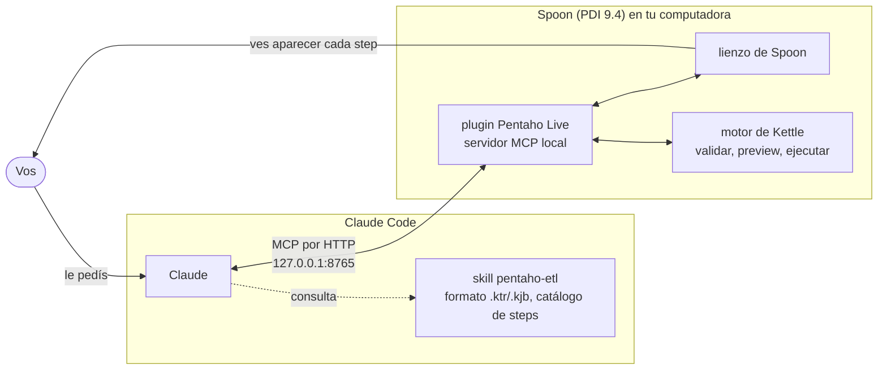

<p align="center">
  <br><br>
  <picture>
    <source media="(prefers-color-scheme: dark)" srcset="docs/images/pentaho-live-oscuro.svg">
    
  </picture>
</p>

<p align="center">
  <strong>Claude arma tus ETLs de Pentaho Data Integration (Spoon) en vivo, mientras mirás.</strong><br>
  Un plugin de Spoon que levanta un servidor MCP local, más un plugin de Claude Code con la skill para usarlo.
</p>

<p align="center">
  <a href="https://github.com/IvI2511/pentaho-mcp/releases/latest"></a>
  <a href="LICENSE"></a>
  <a href="#instalar"></a>
  
  
</p>

<p align="center">
  <a href="README.md">English</a> · <strong>Español</strong> · <a href="README.pt.md">Português</a>
</p>

> [!TIP]
> **¿Sos un agente (Claude Code, Codex…) y te pidieron instalar esto?** Seguí [`INSTALL.md`](INSTALL.md).

<!-- GIF DE DEMO: reemplazar este comentario y la línea de abajo por
<p align="center"></p>
-->
<p align="center"><em>El GIF de demo se agrega pronto: Claude arma una transformación y cada step aparece en Spoon.</em></p>

## Qué hace

Abrís Spoon, le pedís a Claude un ETL con tus palabras y lo ves pasar en el lienzo: Claude agrega los
steps, los conecta y los configura, revisa qué campos salen de cada uno, valida, muestra filas reales de
preview y ejecuta la transformación. Cada cambio pasa por el deshacer de Spoon, así que **Ctrl+Z**
siempre funciona.

¿No tenés Spoon abierto? La skill igual sirve: Claude escribe el `.ktr` / `.kjb` y lo prueba con Pan o
Kitchen.

## Qué le podés pedir

| Le decís… | Claude… |
|---|---|
| *"Armá una transformación que lea `ventas.csv`, le agregue la ciudad desde `clientes.csv`, sume el importe por ciudad y lo escriba en un CSV."* | la arma step por step en el lienzo, la valida y te muestra el resultado |
| *"Agregá un Filter rows después del CSV input que deje las filas con saldo > 1000 y mostrame el preview."* | inserta el step en la transformación abierta y te muestra las filas que pasan |
| *"Conectate a mi base PostgreSQL y cargá este archivo en la tabla `clientes`."* | agrega la conexión (la contraseña la escribís vos en Spoon), lista tablas y columnas y mapea los campos |
| *"Hacé un job que corra estas dos transformaciones en orden y que pare si falla la primera."* | arma el job con sus entradas y los hops de éxito / error |
| *"El lienzo es un lío, ordenalo."* | acomoda los steps de izquierda a derecha, sin líneas cruzadas |
| *"¿Por qué este `.ktr` falla en Pan?"* | lo lee, encuentra el problema con la lista de errores verificados y lo corrige |

## Cómo funciona



- El **plugin de Spoon** es un plugin de ciclo de vida de Kettle. Cuando abre Spoon, levanta un servidor
  MCP en `127.0.0.1:8765` con unas 50 herramientas y aplica cada cambio en el hilo de interfaz de Spoon,
  con deshacer.
- El **plugin de Claude Code `pentaho-live`** conecta a Claude con ese servidor y suma la skill
  `pentaho-etl`, para que Claude use los ids de step y el XML exactos en vez de adivinarlos.

## Instalar

**Lo más fácil: pedíselo a tu agente.** En Claude Code o Codex escribí:

> instalá IvI2511/pentaho-mcp

El agente sigue [`INSTALL.md`](INSTALL.md): te pregunta si ya tenés Pentaho, baja lo que falta, instala
el plugin de Spoon y se configura solo.

| Si… | Bajás del [último release](https://github.com/IvI2511/pentaho-mcp/releases/latest) | Script de Windows |
|---|---|---|
| **ya tenés PDI** | `pentaho-mcp.zip` (el plugin de Spoon, ~140 KB): se descomprime en `data-integration/plugins/` | `instalar.ps1 -PdiHome <data-integration>` |
| **no tenés PDI** | `pdi-ce-9.4-con-pentaho-mcp.zip` (PDI 9.4 CE con el plugin ya puesto, ~370 MB) | `instalar.ps1 -InstalarPdi` |
| **preferís un instalador de Windows** | `Instalador_PentahoLive_X.Y.Z.exe`: PDI 9.4 CE + plugin + Java 21, o solo el plugin en tu PDI; acceso en el menú Inicio y el comando `pentaho-live`. Todavía no está firmado: en el aviso de SmartScreen, **Más información → Ejecutar de todas formas** ([detalles](INSTALL.md#option-c--windows-installer-exe)) | no hace falta |

Después abrí Spoon, reiniciá Claude Code (o corré `/reload-plugins`) y pedile tu primer ETL.

<details>
<summary><strong>Instalación a mano y otros agentes</strong></summary>

**Plugin de Claude Code:**

```
/plugin marketplace add IvI2511/pentaho-mcp
/plugin install pentaho-live@pentaho-tools
```

En la app de escritorio de Claude: **Settings → Plugins → Add → marketplace** `IvI2511/pentaho-mcp`, y
después instalá **Pentaho Live** desde **Discover**.

**Plugin de Spoon con el script, Windows (PowerShell):**

```powershell
Invoke-WebRequest -UseBasicParsing https://raw.githubusercontent.com/IvI2511/pentaho-mcp/main/instalar.ps1 -OutFile $env:TEMP\instalar-pentaho-mcp.ps1
powershell -ExecutionPolicy Bypass -File $env:TEMP\instalar-pentaho-mcp.ps1 -PdiHome "C:\ruta\a\data-integration"
```

Sin `-PdiHome` el script busca en las carpetas habituales; `-InstalarPdi` baja PDI 9.4 CE con el plugin
ya puesto.

**macOS / Linux:**

```bash
curl -fsSL https://raw.githubusercontent.com/IvI2511/pentaho-mcp/main/instalar.sh -o /tmp/instalar-pentaho-mcp.sh
bash /tmp/instalar-pentaho-mcp.sh --pdi "/ruta/a/data-integration"   # o --instalar-pdi
```

**Codex:** `codex mcp add pentaho --url http://127.0.0.1:8765/mcp`, y copiá `claude/skills/pentaho-etl`
a `~/.codex/skills/pentaho-etl`.

**Para probar:** con Spoon abierto, `curl http://127.0.0.1:8765/ping` responde `{"ok":true,"spoon":true,...}`.

**Otro puerto:** corré el script con `-Puerto 8770` (le pone `PENTAHO_MCP_PORT` a Spoon) y cambiá la
opción `mcp_url` del plugin a `http://127.0.0.1:8770/mcp` en `/config`.

Códigos de salida, problemas comunes y todos los pasos: [`INSTALL.md`](INSTALL.md) (en inglés).

</details>

## Qué incluye

| Pieza | Qué es | Dónde |
|---|---|---|
| **Plugin de Spoon** | `@LifecyclePlugin` de Kettle que levanta el servidor MCP al abrir Spoon (bytecode Java 8, compilado contra PDI 9.4) | [`spoon-plugin/`](spoon-plugin/) |
| **Skill `pentaho-etl`** | Formato `.ktr` / `.kjb`, catálogo de 216 steps y 77 job entries generado desde una instalación real, guía comentada de los steps más usados, ejemplos que corren y los errores que dan de verdad Pan y Kitchen | [`claude/skills/pentaho-etl/`](claude/skills/pentaho-etl/) |
| **Conexión MCP `pentaho`** | Apunta Claude Code al plugin de Spoon (dirección configurable con `mcp_url`) | [`claude/.mcp.json`](claude/.mcp.json) |
| **Instaladores** | Encuentran o bajan PDI, instalan el plugin de Spoon y configuran Claude Code y Codex | [`instalar.ps1`](instalar.ps1), [`instalar.sh`](instalar.sh) |

<details>
<summary><strong>Qué cubren las herramientas MCP</strong></summary>

| Área | Qué puede hacer Claude |
|---|---|
| Documentos | Ver qué hay abierto; crear, abrir, guardar, cambiar y cerrar transformaciones y jobs |
| Steps y hops | Buscar un tipo de step y su XML por defecto; agregar, configurar, renombrar, mover, borrar y conectar steps; habilitar o deshabilitar hops; elegir si un step copia o reparte las filas |
| Jobs | Agregar, configurar y conectar entradas; hops de éxito / error / incondicionales |
| Campos | Listar los campos que salen de cada step, antes de configurar el siguiente |
| Controles | Validar; preview de filas reales de cualquier step |
| Ejecución | Ejecutar una transformación o un job, seguir su estado y su log, detenerlo |
| Bases de datos | Listar tipos de conexión; agregar, probar y borrar conexiones; ver tablas y columnas; correr consultas SQL (solo lectura salvo que pidas escribir) |
| Parámetros | Listar, definir y borrar parámetros |
| Lienzo | Agregar notas, seleccionar steps, ordenar el lienzo |

</details>

## Privacidad y seguridad

Todo corre en tu computadora. No hay servidores, cuentas, analíticas ni telemetría.

- La conexión MCP va solo a `http://127.0.0.1:8765/mcp`. El plugin de Spoon escucha únicamente en la
  interfaz loopback y rechaza pedidos de páginas web de otros orígenes.
- Las contraseñas de las bases se enmascaran antes de devolverle cualquier cosa a Claude. Lo recomendado
  es que escribas las contraseñas vos en Spoon.
- Solo se escriben archivos donde le pedís a Claude que guarde; las transformaciones se ejecutan solo
  cuando lo pedís.
- Lo que devuelven las herramientas (steps, nombres de campos, logs, filas de preview) pasa a ser parte
  de tu conversación con Claude, como cualquier otra cosa que compartas.

Política completa: [`PRIVACY.md`](PRIVACY.md) (en inglés).

## Compatibilidad

| | Estado |
|---|---|
| Pentaho Data Integration | **9.4 CE** (probado con 9.4.0.0-343) |
| Java | **11 o posterior** (probado con Java 21) |
| Windows | Probado |
| macOS / Linux | Debería andar, todavía sin probar: [se agradecen reportes](https://github.com/IvI2511/pentaho-mcp/issues) |
| Agentes | Claude Code (CLI y app de escritorio); Codex con la URL del MCP y la skill |

## Limitaciones

- **ChatGPT en la web no se puede conectar**: solo usa servidores MCP públicos por HTTPS, y este escucha
  en `127.0.0.1` a propósito. En el chat de claude.ai solo sirve la skill; para editar en vivo hace falta
  un agente en la misma computadora donde corre Spoon.
- **PDI no trae drivers de MySQL, MariaDB, SQL Server ni Oracle** (sí de PostgreSQL, SQLite y H2).
  Copiá el `.jar` del conector a `data-integration/lib/` y reiniciá Spoon (con MySQL Connector/J 8+
  alcanza el tipo de conexión MySQL normal).
- El PDI 9.4 CE del release no tiene contenedor OSGi (karaf), así que faltan los steps de big data y
  streaming que dependen de él. Los 216 steps del catálogo están todos.
- Abrí Spoon antes de arrancar el agente; si el agente arrancó primero, reinicialo para que vea las
  herramientas.

## Lo que viene (0.4.0)

En preparación para la próxima versión: un informe del ETL en Markdown con diagrama Mermaid, una herramienta que saca
una imagen del lienzo, armar varios steps en una sola llamada, un solo Ctrl+Z por herramienta, nombres de
herramientas en inglés y el catálogo de steps como recursos MCP. Detalle en
[`CHANGELOG.md`](CHANGELOG.md).

## Desarrollo

| Qué | Cómo |
|---|---|
| Compilar el plugin de Spoon | `powershell -ExecutionPolicy Bypass -File spoon-plugin\build.ps1 -PdiHome <data-integration>` → `spoon-plugin/dist/` |
| Validar el plugin de Claude | `claude plugin validate --strict claude` y `claude plugin validate --strict .` |
| Regenerar el catálogo de steps | `bash tools/generador-catalogo/generar.sh <data-integration>` |
| Diseño interno (API de Spoon, hilos, diálogos a evitar) | [`docs/api-spoon.md`](docs/api-spoon.md) |

Las contribuciones son bienvenidas: mirá [`CONTRIBUTING.md`](CONTRIBUTING.md). La documentación interna
y los comentarios del código están en español; la skill, las herramientas MCP, la ficha del plugin y la
documentación para usuarios, en inglés.

## Licencia

[MIT](LICENSE) © IvI2511

---

<sub>Proyecto comunitario independiente. Sin relación con Hitachi Vantara, que no lo respalda ni le da
soporte. Pentaho es una marca de Hitachi Vantara. PDI 9.4 CE lo distribuye Hitachi Vantara con licencia
Apache 2.0.</sub>
