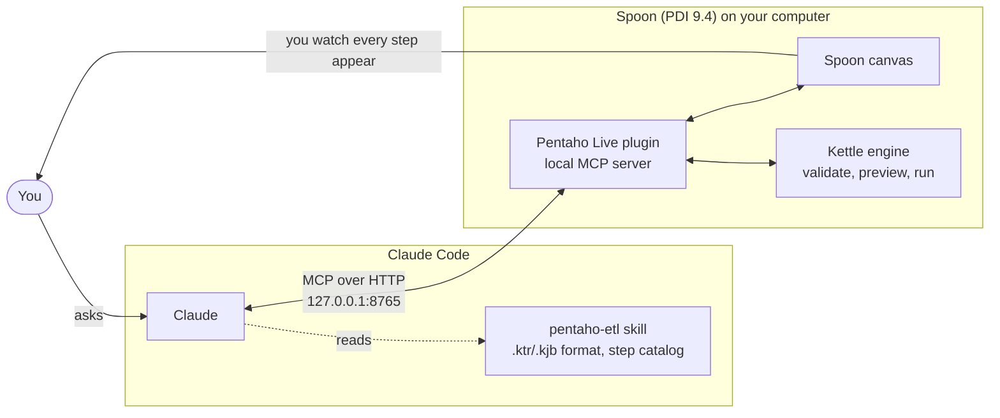

<p align="center">
  <br><br>
  <picture>
    <source media="(prefers-color-scheme: dark)" srcset="docs/images/pentaho-live-oscuro.svg">
    
  </picture>
</p>

<p align="center">
  <strong>Claude builds your Pentaho Data Integration (Spoon) ETLs live, while you watch.</strong><br>
  A Spoon plugin that runs a local MCP server, plus a Claude Code plugin with the skill to use it.
</p>

<p align="center">
  <a href="https://github.com/IvI2511/pentaho-mcp/releases/latest"></a>
  <a href="LICENSE"></a>
  <a href="#install"></a>
  
  
</p>

<p align="center">
  <strong>English</strong> · <a href="README.es.md">Español</a> · <a href="README.pt.md">Português</a>
</p>

> [!TIP]
> **Are you an agent (Claude Code, Codex…) asked to install this?** Follow [`INSTALL.md`](INSTALL.md).

<!-- DEMO GIF: replace this comment and the line below with
<p align="center"></p>
-->
<p align="center"><em>Demo GIF coming soon: Claude building a transformation while each step appears in Spoon.</em></p>

## What it does

Open Spoon, ask Claude for an ETL in plain words, and watch it happen on the canvas: Claude adds the
steps, connects and configures them, checks the fields each one outputs, validates, previews real rows
and runs the transformation. Every change goes through Spoon's own undo, so **Ctrl+Z** always works.

No Spoon open? The skill still helps: Claude writes the `.ktr` / `.kjb` file and checks it with Pan or
Kitchen.

## What you can ask

| You say… | Claude… |
|---|---|
| *"Build a transformation that reads `ventas.csv`, adds the city from `clientes.csv`, sums the amount per city and writes a CSV."* | creates it step by step on the canvas, validates it and previews the result |
| *"Add a Filter rows after the CSV input that keeps rows with saldo > 1000 and preview the result."* | inserts the step in the open transformation and shows you the rows that pass |
| *"Connect to my PostgreSQL database and load this file into the `clientes` table."* | adds the connection (you type the password in Spoon), lists tables and columns, maps the fields |
| *"Make a job that runs these two transformations in order and stops if the first one fails."* | builds the job with its entries and success / failure hops |
| *"The canvas is a mess, tidy it up."* | lays out the steps left to right, with no crossed lines |
| *"Why does this `.ktr` fail in Pan?"* | reads it, finds the problem with the verified error list and fixes it |

## How it works



- The **Spoon plugin** is a Kettle lifecycle plugin. When Spoon opens, it starts an MCP server on
  `127.0.0.1:8765` with about 50 tools, and applies every edit on Spoon's UI thread with undo support.
- The **Claude Code plugin `pentaho-live`** connects Claude to that server and adds the `pentaho-etl`
  skill, so Claude knows the exact step ids and XML instead of guessing.

## Install

**Easiest: ask your agent.** In Claude Code or Codex, type:

> install IvI2511/pentaho-mcp

It follows [`INSTALL.md`](INSTALL.md): asks whether you already have Pentaho, downloads what's missing,
installs the Spoon plugin and configures itself.

| If you… | Download from the [latest release](https://github.com/IvI2511/pentaho-mcp/releases/latest) | Windows script |
|---|---|---|
| **already have PDI** | `pentaho-mcp.zip` (the Spoon plugin, ~140 KB): unzip into `data-integration/plugins/` | `instalar.ps1 -PdiHome <data-integration>` |
| **don't have PDI** | `pdi-ce-9.4-con-pentaho-mcp.zip` (PDI 9.4 CE with the plugin already in place, ~370 MB) | `instalar.ps1 -InstalarPdi` |

Then open Spoon, restart Claude Code (or run `/reload-plugins`) and ask for your first ETL.

<details>
<summary><strong>Manual install and other agents</strong></summary>

**Claude Code plugin:**

```
/plugin marketplace add IvI2511/pentaho-mcp
/plugin install pentaho-live@pentaho-tools
```

In the Claude desktop app: **Settings → Plugins → Add → marketplace** `IvI2511/pentaho-mcp`, then
install **Pentaho Live** from **Discover**.

**Spoon plugin with the script, Windows (PowerShell):**

```powershell
Invoke-WebRequest -UseBasicParsing https://raw.githubusercontent.com/IvI2511/pentaho-mcp/main/instalar.ps1 -OutFile $env:TEMP\instalar-pentaho-mcp.ps1
powershell -ExecutionPolicy Bypass -File $env:TEMP\instalar-pentaho-mcp.ps1 -PdiHome "C:\path\to\data-integration"
```

Without `-PdiHome` the script searches the usual folders; `-InstalarPdi` downloads PDI 9.4 CE with the
plugin in place.

**macOS / Linux:**

```bash
curl -fsSL https://raw.githubusercontent.com/IvI2511/pentaho-mcp/main/instalar.sh -o /tmp/instalar-pentaho-mcp.sh
bash /tmp/instalar-pentaho-mcp.sh --pdi "/path/to/data-integration"   # or --instalar-pdi
```

**Codex:** `codex mcp add pentaho --url http://127.0.0.1:8765/mcp`, and copy
`claude/skills/pentaho-etl` to `~/.codex/skills/pentaho-etl`.

**Check it:** with Spoon open, `curl http://127.0.0.1:8765/ping` answers `{"ok":true,"spoon":true,...}`.

**Different port:** run the script with `-Puerto 8770` (it sets `PENTAHO_MCP_PORT` for Spoon) and set
the plugin option `mcp_url` to `http://127.0.0.1:8770/mcp` in `/config`.

Exit codes, troubleshooting and the full step list: [`INSTALL.md`](INSTALL.md).

</details>

## What's inside

| Piece | What it is | Where |
|---|---|---|
| **Spoon plugin** | Kettle `@LifecyclePlugin` that starts the MCP server when Spoon opens (Java 8 bytecode, built against PDI 9.4) | [`spoon-plugin/`](spoon-plugin/) |
| **Skill `pentaho-etl`** | `.ktr` / `.kjb` format, catalog of 216 steps and 77 job entries generated from a real install, an annotated guide to the most used steps, runnable examples and the errors Pan and Kitchen actually give | [`claude/skills/pentaho-etl/`](claude/skills/pentaho-etl/) |
| **MCP connection `pentaho`** | Points Claude Code at the Spoon plugin (address configurable with `mcp_url`) | [`claude/.mcp.json`](claude/.mcp.json) |
| **Installers** | Find or download PDI, install the Spoon plugin, configure Claude Code and Codex | [`instalar.ps1`](instalar.ps1), [`instalar.sh`](instalar.sh) |

<details>
<summary><strong>What the MCP tools cover</strong></summary>

| Area | What Claude can do |
|---|---|
| Documents | See what's open, create, open, save, switch and close transformations and jobs |
| Steps and hops | Find a step type and its default XML, add, configure, rename, move, delete and connect steps; enable or disable hops; choose whether a step copies or distributes rows |
| Jobs | Add, configure and connect job entries; set success / failure / unconditional hops |
| Fields | List the fields each step outputs, before configuring the next one |
| Checks | Validate, preview real rows from any step |
| Running | Run a transformation or job, follow its status and logs, stop it |
| Databases | List connection types, add, test and delete connections, browse tables and columns, run SQL queries (read-only unless you ask for writes) |
| Parameters | List, set and delete parameters |
| Canvas | Add notes, select steps, tidy the layout |

</details>

## Privacy and security

Everything runs on your computer. There are no servers, accounts, analytics or telemetry.

- The MCP connection only goes to `http://127.0.0.1:8765/mcp`. The Spoon plugin listens on the loopback
  interface only and rejects requests from web pages of other origins.
- Database passwords are masked before anything is returned to Claude. The recommended way is to type
  passwords yourself in Spoon.
- Files are written only where you ask Claude to save; transformations run only when you ask.
- What the tools return (steps, field names, logs, preview rows) becomes part of your conversation with
  Claude, like anything else you share.

Full policy: [`PRIVACY.md`](PRIVACY.md).

## Compatibility

| | Status |
|---|---|
| Pentaho Data Integration | **9.4 CE** (tested with 9.4.0.0-343) |
| Java | **11 or later** (tested with Java 21) |
| Windows | Tested |
| macOS / Linux | Should work, not tested yet: [reports welcome](https://github.com/IvI2511/pentaho-mcp/issues) |
| Agents | Claude Code (CLI and desktop app); Codex through the MCP URL and the skill |

## Limitations

- **ChatGPT on the web can't connect**: it only uses public HTTPS MCP servers, and this one listens on
  `127.0.0.1` on purpose. In claude.ai chat only the skill is useful; live editing needs an agent on the
  computer where Spoon runs.
- **No MySQL, MariaDB, SQL Server or Oracle drivers** ship with PDI (PostgreSQL, SQLite and H2 do). Copy the connector `.jar` into
  `data-integration/lib/` and restart Spoon (with MySQL Connector/J 8+ the regular MySQL connection type
  works).
- The bundled PDI 9.4 CE has no OSGi container (karaf), so the big-data and streaming steps that depend on
  it are missing. The 216 steps in the catalog are there.
- Open Spoon before starting the agent; if the agent started first, restart it so it sees the tools.

## What's next (0.4.0)

In progress for the next release: an ETL report in Markdown with a Mermaid diagram, a canvas screenshot
tool, building several steps in one call, one Ctrl+Z per tool call, tool names in English and the step
catalog exposed as MCP resources. See [`CHANGELOG.md`](CHANGELOG.md).

## Development

| What | How |
|---|---|
| Build the Spoon plugin | `powershell -ExecutionPolicy Bypass -File spoon-plugin\build.ps1 -PdiHome <data-integration>` → `spoon-plugin/dist/` |
| Validate the Claude plugin | `claude plugin validate --strict claude` and `claude plugin validate --strict .` |
| Regenerate the step catalog | `bash tools/generador-catalogo/generar.sh <data-integration>` |
| Internal design (Spoon API, threads, dialogs to avoid) | [`docs/api-spoon.md`](docs/api-spoon.md) (Spanish) |

Contributions are welcome: see [`CONTRIBUTING.md`](CONTRIBUTING.md). The skill and the internal docs are
written in Spanish; the plugin listing and the user docs are in English.

## License

[MIT](LICENSE) © IvI2511

---

<sub>Independent community project. Not affiliated with, endorsed by or supported by Hitachi Vantara.
Pentaho is a trademark of Hitachi Vantara. PDI 9.4 CE is distributed by Hitachi Vantara under the Apache
2.0 license.</sub>
