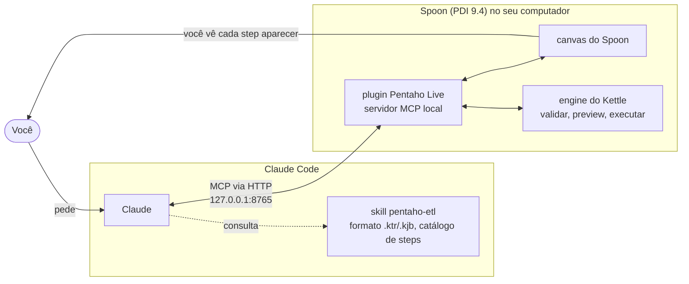

<p align="center">
  <br><br>
  <picture>
    <source media="(prefers-color-scheme: dark)" srcset="docs/images/pentaho-live-oscuro.svg">
    
  </picture>
</p>

<p align="center">
  <strong>O Claude monta seus ETLs do Pentaho Data Integration (Spoon) ao vivo, enquanto você assiste.</strong><br>
  Um plugin do Spoon que sobe um servidor MCP local, mais um plugin do Claude Code com a skill para usá-lo.
</p>

<p align="center">
  <a href="https://github.com/IvI2511/pentaho-mcp/releases/latest"></a>
  <a href="LICENSE"></a>
  <a href="#instalação"></a>
  
  
</p>

<p align="center">
  <a href="README.md">English</a> · <a href="README.es.md">Español</a> · <strong>Português</strong>
</p>

> [!TIP]
> **Você é um agente (Claude Code, Codex…) e pediram para instalar isto?** Siga o [`INSTALL.md`](INSTALL.md).

<!-- GIF DE DEMONSTRAÇÃO: substituir este comentário e a linha abaixo por
<p align="center"></p>
-->
<p align="center"><em>O GIF de demonstração chega em breve: o Claude monta uma transformação e cada step aparece no Spoon.</em></p>

## O que ele faz

Abra o Spoon, peça ao Claude um ETL com suas palavras e veja tudo acontecer no canvas: o Claude adiciona
os steps, conecta e configura cada um, confere os campos que saem de cada step, valida, mostra linhas
reais de preview e executa a transformação. Toda alteração passa pelo desfazer do próprio Spoon, então o
**Ctrl+Z** sempre funciona.

**Relatórios.** O Spoon ganha uma nova perspectiva, **Relatórios**, que documenta sozinha a
transformação ou o job aberto: capa, diagrama de fluxo, linhagem de campos, dicionário de dados, modelo
das tabelas de destino, perfil de dados, métricas de execução com gráficos, validação, qualidade técnica,
conexões e parâmetros. Exporta para HTML, PDF, Markdown (para Obsidian ou GitHub), PowerPoint, Word, Excel
e imagens de cada diagrama, de um documento ou de vários combinados num só arquivo, com seu nome,
instituição, logo e cores. O Claude pode montar o mesmo relatório e acrescentar uma narrativa curta
escrita a partir dos números reais.

**Qualidade.** O Claude também pode revisar um ETL procurando o que o Kettle deixa passar sem erro: Group
by ou Merge join sem ordenar, o símbolo decimal vazio que, num computador configurado em espanhol,
transforma `2.50` em `250`, caminhos fixos, senhas gravadas no arquivo, um ramo de erro que termina em
Success. Você recebe uma pontuação de qualidade técnica de 0 a 100 que mostra de onde sai cada ponto
perdido, e as correções seguras são aplicadas com um único Ctrl+Z (antes das que mudam o que o ETL faz, o
Claude pergunta). A mesma revisão é uma seção do relatório.

**Corretor.** Para professores: a partir da solução se monta um pacote de exercício (um caso visível e outro
oculto com outros dados, a saída esperada, regras e uma rubrica) e se corrige uma pasta inteira de entregas.
Cada uma roda numa JVM à parte, nunca dentro do Spoon, e sua saída é comparada linha a linha com a esperada:
você recebe a nota com os critérios que falharam, uma dica para cada erro típico (Group by sem ordenar,
símbolo decimal vazio, duplicados não removidos, caminhos fixos), a devolutiva de cada aluno sem os valores
do caso oculto e uma planilha para o Excel. O Spoon ganha a perspectiva **Corretor** com o mesmo e um
assistente que monta o pacote a partir da transformação aberta. Desde a 0.6.2 também corrige cargas em MySQL,
MariaDB, PostgreSQL ou H2 sobre bases de teste descartáveis que recria antes de cada caso (nunca as suas bases; a
senha nunca vai no pacote).

**Modo aula.** O Claude também pode *ensinar* um ETL: monta a transformação devagar, um step a cada
clique em **Próximo ▶** numa nova aba **Lição**, e explica cada step com uma nota numerada no canvas (o que
faz, por que está ali, o erro típico), com as primeiras linhas depois de cada passo. Feito para uma aula
projetada ou para aprender sozinho; no fim, as notas podem ser ocultadas para o exercício e a lição vira
uma apostila em PDF ou Word. A skill traz três lições testadas (filtrar, Sort + Group by, Stream lookup vs
Merge join) em português, inglês e espanhol.

**Robustez.** Peça ao Claude que uma carga tolere dados sujos: cada linha ruim (um campo que falta, uma
data que não dá para ler, um texto longo demais para a coluna, uma venda de um cliente que não existe) vai
para um arquivo de rejeitados com o motivo, em vez de parar a carga ou sumir. O Claude encontra o que
falta, mostra o plano e aplica tudo com um único Ctrl+Z; depois prova com um teste de dados sujos: cópias
quebradas dos seus arquivos de entrada rodam contra uma cópia da transformação num ambiente isolado, e o
teste confere que cada linha lida foi carregada ou rejeitada com o motivo, e que rodar duas vezes não
duplica nada.

**Testes.** Congele o que uma transformação produz hoje e fique sabendo quando uma mudança altera isso:
um teste troca os steps de entrada por datasets fixos (CSV), roda a transformação em uma JVM separada e
compara a saída dos steps escolhidos com CSVs dourados, linha a linha: linhas que faltam, que sobram e
valores que mudam, com a chave, a coluna, o esperado e o obtido. Crie a partir do que uma pré-visualização
mostra (`test_create`, ou **IDC › Testes… › Criar teste a partir da pré-visualização…**), rode com o Claude
(`test_run`, `test_run_all`) ou na janela **Testes…**, em verde ou vermelho, e, se quiser, ao salvar: só os
testes afetados pela mudança rodam em segundo plano e o botão IDC mostra **✓ 12/12** ou **✗ 1**. Os testes
ficam em `tests/` ao lado do `.ktr` (formato:
[`docs/schemas/pentaho-live-test-1.schema.json`](docs/schemas/pentaho-live-test-1.schema.json)); podem pular
um Table output, definir variáveis e carregar bancos de teste descartáveis, como o corretor.

**Menu IDC.** A barra principal do Spoon ganha um menu suspenso **IDC** logo ao lado do seletor de
perspectivas, com tudo isso à mão sem pedir ao Claude: **Revisar qualidade…** (pontuação, achados com como
corrigi-los, clique em um para ver o seu step na tela, as correções automáticas com um único Ctrl+Z,
silenciar uma regra onde ela é deliberada e uma revisão profunda opcional que lê dados), **Robustecer…** (o
plano com caixas de seleção, aplicá-lo com um único Ctrl+Z e o teste com dados sujos com o seu veredito),
**Organizar tela**, **Lição**, a troca para Data Integration, Relatórios ou Corretor e **Sobre o Pentaho
Live**.

**Projetos em equipe.** Um projeto ou um curso compartilha as suas convenções em um arquivo,
`.pentaho-live/lint.yaml`: quais regras de qualidade rodam e com que gravidade, a pontuação mínima, um prefixo por
categoria de step (`IN_`, `OUT_`, `LKP_`, `FLT_`…), descrição em cada step, `${DIR_DATOS}` e `${DB_HOST}` em vez de
caminhos e hosts escritos à mão, e regras próprias da equipe como padrões. O Claude, **Revisar qualidade…**
("Perfil: Curso (…) · mínimo 75: atingido"), os relatórios e o corretor o usam sozinhos, e renomear conforme a
convenção se desfaz com um Ctrl+Z. `pentaho-live init` (ou **IDC > Preparar projeto…**, ou pedindo ao Claude) cria
só o que falta em um repositório de equipe: `etl/`, `datasets/`, `tests/`, `contracts/`, `env/`, `.gitignore`,
`.gitattributes`, esse perfil, um README com as convenções e um workflow do GitHub Actions que instala o PDI com o
Pentaho Live (com cache) e faz o pull request falhar se um `.ktr` não chega ao mínimo (`pentaho-live lint etl`).

Sem o Spoon aberto? A skill continua útil: o Claude escreve o `.ktr` / `.kjb` e testa com o Pan ou o
Kitchen.

## O que você pode pedir

| Você diz… | O Claude… |
|---|---|
| *"Monte uma transformação que leia `ventas.csv`, traga a cidade de `clientes.csv`, some o valor por cidade e grave em um CSV."* | monta step por step no canvas, valida e mostra o resultado |
| *"Adicione um Filter rows depois do CSV input que mantenha as linhas com saldo > 1000 e mostre o preview."* | insere o step na transformação aberta e mostra as linhas que passam |
| *"Conecte no meu banco PostgreSQL e carregue este arquivo na tabela `clientes`."* | cria a conexão (você digita a senha no Spoon), lista tabelas e colunas e mapeia os campos |
| *"Crie um job que rode estas duas transformações em sequência e pare se a primeira falhar."* | monta o job com as entradas e os hops de sucesso / falha |
| *"O canvas está uma bagunça, organize."* | alinha os steps da esquerda para a direita, sem linhas cruzadas |
| *"Por que este `.ktr` falha no Pan?"* | lê o arquivo, encontra o problema na lista de erros verificados e corrige |
| *"Revise as boas práticas desta transformação antes de eu entregar e corrija o que for seguro."* | roda a revisão de qualidade, explica cada achado, aplica as correções seguras com um Ctrl+Z e pergunta antes do resto |
| *"Dê a lição de Stream lookup passo a passo, nível iniciante, em português."* | monta um step a cada clique em Próximo ▶, com uma nota numerada no canvas por step e as linhas que ele produz |
| *"Faça um relatório desta transformação para o trabalho, em PDF e PowerPoint, com uma conclusão curta."* | monta o relatório (linhagem, dicionário de dados, métricas…), escreve a conclusão com os dados reais e exporta os dois arquivos |
| *"Monte um pacote de correção a partir desta solução, com um caso oculto, e depois corrija as entregas de `C:\TP3\entregas`."* | roda a solução para obter a saída esperada, corrige cada entrega em JVMs à parte e resume as notas, quem errou o quê e por quê; a planilha e a devolutiva de cada aluno ficam na pasta de resultados |
| *"Congele a saída de «Redondear importe» como teste e depois me diga se a minha mudança quebrou algo."* | cria o teste com as linhas de hoje, roda depois da sua mudança e explica a diferença linha a linha se ficar vermelho |

## Como funciona



- O **plugin do Spoon** é um plugin de ciclo de vida do Kettle. Quando o Spoon abre, ele sobe um servidor
  MCP em `127.0.0.1:8765` com 77 ferramentas e aplica cada alteração na thread de interface do
  Spoon, com desfazer. O mesmo jar acrescenta as perspectivas **Relatórios** e **Corretor** ao seletor de
  perspectivas do Spoon.
- O **plugin do Claude Code `pentaho-live`** conecta o Claude a esse servidor e inclui a skill
  `pentaho-etl`, para que o Claude use os ids de step e o XML exatos em vez de adivinhar.

## Instalação

**O jeito mais fácil: peça ao seu agente.** No Claude Code ou no Codex, digite:

> instale IvI2511/pentaho-mcp

O agente segue o [`INSTALL.md`](INSTALL.md): pergunta se você já tem o Pentaho, baixa o que falta,
instala o plugin do Spoon e se configura sozinho.

| Se você… | Baixe da [última release](https://github.com/IvI2511/pentaho-mcp/releases/latest) | Script do Windows |
|---|---|---|
| **já tem o PDI** | `pentaho-mcp.zip` (o plugin do Spoon, ~11 MB com a biblioteca do PowerPoint): descompacte em `data-integration/plugins/` | `instalar.ps1 -PdiHome <data-integration>` |
| **não tem o PDI** | `pdi-ce-9.4-con-pentaho-mcp.zip` (PDI 9.4 CE com o plugin já no lugar, ~370 MB) | `instalar.ps1 -InstalarPdi` |
| **prefere um instalador do Windows** | `Instalador_PentahoLive_X.Y.Z.exe`: PDI 9.4 CE + plugin + Java 21, ou só o plugin no seu PDI; atalho no menu Iniciar e o comando `pentaho-live`. Ainda não é assinado: no aviso do SmartScreen, **Mais informações → Executar assim mesmo** ([detalhes](INSTALL.md#option-c--windows-installer-exe)) | não precisa |

Depois abra o Spoon, reinicie o Claude Code (ou rode `/reload-plugins`) e peça seu primeiro ETL.

<details>
<summary><strong>Instalação manual e outros agentes</strong></summary>

**Plugin do Claude Code:**

```
/plugin marketplace add IvI2511/pentaho-mcp
/plugin install pentaho-live@pentaho-tools
```

No app desktop do Claude: **Settings → Plugins → Add → marketplace** `IvI2511/pentaho-mcp` e depois
instale o **Pentaho Live** em **Discover**.

**Plugin do Spoon com o script, Windows (PowerShell):**

```powershell
Invoke-WebRequest -UseBasicParsing https://raw.githubusercontent.com/IvI2511/pentaho-mcp/main/instalar.ps1 -OutFile $env:TEMP\instalar-pentaho-mcp.ps1
powershell -ExecutionPolicy Bypass -File $env:TEMP\instalar-pentaho-mcp.ps1 -PdiHome "C:\caminho\para\data-integration"
```

Sem `-PdiHome` o script procura nas pastas de costume; `-InstalarPdi` baixa o PDI 9.4 CE com o plugin já
no lugar.

**macOS / Linux:**

```bash
curl -fsSL https://raw.githubusercontent.com/IvI2511/pentaho-mcp/main/instalar.sh -o /tmp/instalar-pentaho-mcp.sh
bash /tmp/instalar-pentaho-mcp.sh --pdi "/caminho/para/data-integration"   # ou --instalar-pdi
```

**Codex:** `codex mcp add pentaho --url http://127.0.0.1:8765/mcp` e copie `claude/skills/pentaho-etl`
para `~/.codex/skills/pentaho-etl`.

**Para testar:** com o Spoon aberto, `curl http://127.0.0.1:8765/ping` responde `{"ok":true,"spoon":true,...}`.

**Outra porta:** rode o script com `-Puerto 8770` (ele define `PENTAHO_MCP_PORT` para o Spoon) e mude a
opção `mcp_url` do plugin para `http://127.0.0.1:8770/mcp` em `/config`.

Códigos de saída, solução de problemas e todos os passos: [`INSTALL.md`](INSTALL.md) (em inglês).

</details>

## O que vem incluído

| Peça | O que é | Onde |
|---|---|---|
| **Plugin do Spoon** | `@LifecyclePlugin` do Kettle que sobe o servidor MCP quando o Spoon abre, e as perspectivas Relatórios e Corretor (`@SpoonPlugin`) no mesmo jar (bytecode Java 8, compilado contra o PDI 9.4) | [`spoon-plugin/`](spoon-plugin/) |
| **Skill `pentaho-etl`** | Formato `.ktr` / `.kjb`, catálogo de 216 steps e 77 job entries gerado a partir de uma instalação real, guia comentado dos steps mais usados, exemplos que rodam e os erros que o Pan e o Kitchen realmente dão | [`claude/skills/pentaho-etl/`](claude/skills/pentaho-etl/) |
| **Conexão MCP `pentaho`** | Aponta o Claude Code para o plugin do Spoon (endereço configurável com `mcp_url`) | [`claude/.mcp.json`](claude/.mcp.json) |
| **Instaladores** | Encontram ou baixam o PDI, instalam o plugin do Spoon e configuram o Claude Code e o Codex | [`instalar.ps1`](instalar.ps1), [`instalar.sh`](instalar.sh) |

<details>
<summary><strong>O que as ferramentas MCP cobrem</strong></summary>

| Área | O que o Claude pode fazer |
|---|---|
| Documentos | Ver o que está aberto; criar, abrir, salvar, alternar e fechar transformações e jobs |
| Steps e hops | Buscar um tipo de step e seu XML padrão; adicionar, configurar, renomear, mover, excluir e conectar steps; ativar ou desativar hops; escolher se um step copia ou distribui as linhas |
| Jobs | Adicionar, configurar e conectar entradas; hops de sucesso / falha / incondicionais |
| Campos | Listar os campos que saem de cada step, antes de configurar o próximo |
| Verificações | Validar; preview de linhas reais de qualquer step |
| Qualidade | Revisar boas práticas além da validação, com uma pontuação de 0 a 100 (e, se você pedir, lendo as fontes para provar um problema); aplicar as correções propostas; silenciar uma regra onde ela é proposital |
| Modo aula | Reproduzir uma lição passo a passo com notas no canvas e uma aba Lição (ritmo guiado, automático ou manual), acompanhá-la, voltar, ocultar, mostrar ou remover as notas e transformá-la numa apostila |
| Robustez | Encontrar o que pararia uma carga ou perderia linhas com dados sujos; robustecer (rejeitados com o motivo, campos obrigatórios, duplicados, órfãos) com um único Ctrl+Z; provar com um teste de dados sujos num ambiente isolado que só usa cópias e bancos de dados em arquivo |
| Execução | Executar uma transformação ou um job, acompanhar o status e o log, parar |
| Bancos de dados | Listar tipos de conexão; criar, testar e excluir conexões; ver tabelas e colunas; rodar consultas SQL (somente leitura, a menos que você peça escrita) |
| Parâmetros | Listar, definir e excluir parâmetros |
| Canvas | Adicionar notas, selecionar steps, organizar o layout, tirar uma imagem do canvas |
| Corretor | Montar um pacote de exercício a partir de uma solução (casos, casos ocultos, saída esperada, regras, rubrica, cópia para alunos), validá-lo, corrigir uma entrega ou uma pasta inteira em JVMs à parte, acompanhar o lote e obter a planilha e a devolutiva de cada aluno |
| Relatórios | Montar o relatório completo de uma transformação ou de um job (HTML, PDF, Markdown, PowerPoint, Word, Excel, imagens, JSON), sozinho ou com vários documentos combinados, com linhagem, dicionário de dados, métricas, qualidade técnica e uma narrativa opcional; ler os dados dele; abri-lo na perspectiva Relatórios do Spoon; um relatório rápido em Markdown com diagrama Mermaid |

</details>

## Privacidade e segurança

Tudo roda no seu computador. Não há servidores, contas, analytics nem telemetria.

- A conexão MCP vai apenas para `http://127.0.0.1:8765/mcp`. O plugin do Spoon escuta só na interface de
  loopback e recusa requisições de páginas web de outras origens.
- As senhas dos bancos são mascaradas antes de qualquer coisa voltar para o Claude. O recomendado é você
  mesmo digitar as senhas no Spoon.
- Arquivos só são gravados onde você pede ao Claude para salvar; as transformações só rodam quando você
  pede.
- Os relatórios nunca incluem senhas. Podem incluir nomes de hosts, caminhos de arquivos e, no perfil de
  dados e na revisão profunda de qualidade, valores reais dos seus dados (dá para ocultá-los nas
  configurações do relatório). O perfil e a
  opção «Medir» rodam uma cópia da transformação só quando você pede, e essa cópia grava suas saídas como
  uma execução normal.
- A revisão de qualidade (`lint_etl`) não executa a transformação. O modo profundo lê até 5000 linhas das
  suas fontes só quando você pede, com previews limitadas a steps somente leitura, e os achados podem citar
  valores lidos.
- O corretor roda a solução e as entregas só quando você pede, cada uma num processo Java à parte com uma
  configuração do Kettle vazia e sobre cópias dos dados; nunca altera uma entrega e grava os resultados só na
  pasta que você escolher. O modo confiança (deixar rodar steps perigosos) existe só na perspectiva Corretor
  do Spoon, nunca via MCP.
- O teste de dados sujos (`stress_test`) só roda quando você pede, sobre uma cópia da transformação num
  processo Java separado com sua própria configuração do Kettle, e só se todos os bancos de dados que ela
  usa forem arquivos SQLite ou H2 (que ele copia antes). Nunca se conecta a outro banco e só grava numa
  pasta temporária.
- O que as ferramentas devolvem (steps, nomes de campos, logs, linhas de preview) passa a fazer parte da
  sua conversa com o Claude, como qualquer outra coisa que você compartilhe.

Política completa: [`PRIVACY.md`](PRIVACY.md) (em inglês).

## Compatibilidade

| | Status |
|---|---|
| Pentaho Data Integration | **9.4 CE** (testado com 9.4.0.0-343) |
| Java | **11 ou superior** (testado com Java 21) |
| Windows | Testado |
| macOS | Testado no macOS 15 e 26 (GitHub Actions): chip Apple via Rosetta 2 com um Java x64, e Intel. Instalação, Pan e todas as chamadas MCP funcionam; falta conferir a janela do Spoon num Mac de verdade. [Passos](INSTALL.md#macos-and-linux) |
| Linux | Testado no Ubuntu 24.04 e 26.04 (GitHub Actions); precisa do GTK 2 (`libgtk2.0-0t64`) |
| Agentes | Claude Code (CLI e app desktop); Codex com a URL do MCP e a skill |

## Limitações

- **O ChatGPT na web não consegue se conectar**: ele só usa servidores MCP públicos via HTTPS, e este
  escuta em `127.0.0.1` de propósito. No chat do claude.ai só a skill é útil; para editar ao vivo é
  preciso um agente no mesmo computador em que o Spoon roda.
- **O PDI não traz drivers de MySQL, MariaDB, SQL Server nem Oracle** (traz de PostgreSQL, SQLite e H2).
  Copie o `.jar` do conector para `data-integration/lib/` e reinicie o Spoon (com o MySQL Connector/J 8+
  o tipo de conexão MySQL normal funciona).
- O PDI 9.4 CE da release não tem contêiner OSGi (karaf), então faltam os steps de big data e streaming
  que dependem dele. Os 216 steps do catálogo estão todos lá.
- Abra o Spoon antes de iniciar o agente; se o agente iniciou primeiro, reinicie-o para que ele veja as
  ferramentas.
- Corretor: corrigir uma entrega é rodar código escrito por outra pessoa. O processo à parte e a política de
  steps (os de código, rede e exclusão de arquivos são bloqueados) reduzem o risco, mas **não é um sandbox
  de verdade**: para entregas de desconhecidos, use uma máquina virtual. Corrige transformações (`.ktr`);
  jobs ainda não.
- Relatórios: o PDF e as imagens dos diagramas usam o **Microsoft Edge ou o Google Chrome** (o Windows já
  traz o Edge). Sem nenhum dos dois, o PDF sai pela caixa de impressão do navegador e, no PowerPoint, os
  diagramas de linhagem e de tabelas viram tabelas. A pré-visualização dentro do Spoon usa o motor do
  Internet Explorer que vem com o PDI, então não tem diagramas interativos: **Abrir no navegador** mostra o
  relatório completo.
- O modo aula funciona **só com transformações** (ainda não com jobs), uma lição por transformação; com mais
  de 12 passos avisa e sugere dividi-la. Se a lição mostra linhas, salve antes o `.ktr` junto dos dados.

## Novidades da 0.6.2

- **Menu IDC** ao lado do seletor de perspectivas do Spoon: *Revisar qualidade…* (nota, achados, aplicar
  correções com um Ctrl+Z, silenciar uma regra), *Robustecer…* (o plano do `harden_etl` com caixas de
  seleção, aplicar, *Testar com dados sujos…*), *Organizar tela*, *Lição* e a troca de perspectiva, sem pedir
  ao Claude.
- O **corretor de exercícios** corrige cargas em MySQL, MariaDB, PostgreSQL ou H2 sobre bancos de teste
  descartáveis recriados antes de cada caso; as mensagens saem no idioma do Spoon.
- `harden_etl` e `stress_test` respondem em português, inglês ou espanhol, e um ensaio do `harden_etl` não
  marca mais a transformação como alterada. Ver [`CHANGELOG.md`](CHANGELOG.md).

## Novidades da 0.6.1

Correções de robustez: a seção «qualidade» dos relatórios agora inclui os achados de robustez com a sua
pontuação à parte; o `harden_etl` não traça mais um hop de erro por cima de outro step num canvas cheio, e
um Ctrl+Z depois deixa o `.ktr` exatamente como estava; o `stress_test` informa uma linha ruim mesmo quando
uma tabela que falta também parou a execução. Detalhes em [`CHANGELOG.md`](CHANGELOG.md).

## Novidades da 0.6.0

«Calidad y clases» (qualidade e aulas), 73 ferramentas MCP no total:

- **Linter** (`lint_etl`, `apply_lint_fixes`, `suppress_lint`): o que o Kettle deixa passar (um Group by
  sem ordenar antes, o símbolo decimal vazio, caminhos absolutos, senhas no arquivo...) com uma nota de
  qualidade de 0 a 100, as correções seguras num só Ctrl+Z e uma seção de qualidade nos relatórios.
- **Corretor de exercícios** (`create_exercise_pack`, `grade_exercise`, `grade_submissions`...): monte um
  pack a partir da sua solução e corrija uma pasta inteira de entregas, cada uma numa JVM separada, com uma
  dica por erro típico, o retorno de cada aluno e a planilha para Excel. O Spoon ganha a perspectiva
  **Corretor**.
- **Modo aula** (`lesson_start`, `lesson_notes`...): o Claude constrói a transformação um step por clique em
  **Próximo ▶**, com uma nota numerada no canvas para cada step, e a lição vira uma apostila.
- **Robustez** (`lint_etl robustness=true`, `harden_etl`, `stress_test`): cada linha ruim vai para um
  arquivo de rejeitos com o motivo, e cópias quebradas das entradas provam que nenhuma linha se perde e que
  rodar a carga de novo não duplica nada. Nos relatórios, a seção «qualidade» (`quality`) inclui os achados
  de robustez com a sua pontuação à parte: não há uma seção de robustez à parte. Guia:
  `manual/09-robustez.md`.

Detalhes em [`CHANGELOG.md`](CHANGELOG.md).

## Novidades da 0.5.1

A perspectiva **Relatórios** no Spoon e três ferramentas MCP que a acompanham: `build_report` (grava o
relatório em qualquer formato), `get_report_data` (os dados do relatório em JSON, para o Claude escrever
uma narrativa com números reais) e `show_report` (abre o relatório no Spoon). Os relatórios são exportados
para HTML, PDF, Markdown, PowerPoint, **Word**, **Excel** e **imagens** de cada diagrama; vários documentos
(um job e suas transformações, os exercícios de uma entrega) podem ir num só arquivo com capa e sumário.
Os diagramas de fluxo e de linhagem se distribuem em linhas para preencher a página ou o slide. Detalhes
no [`CHANGELOG.md`](CHANGELOG.md).

Também novo:

- **[`ejemplo/`](ejemplo/)**, um exercício de ETL completo como os da faculdade («Grano de Oro», quatro
  cafeterias, dados sujos em CSV, Excel e JSON carregados num modelo estrela em SQLite). Mostra tudo: o
  ETL construído ao vivo na tela do Spoon pelo MCP ([GIF](ejemplo/capturas/construccion-en-vivo.gif)),
  conferido até o último número e documentado pela aba Relatórios ([PDF](ejemplo/informes/04_hechos_ventas.pdf)).
  Em espanhol, com um [roteiro de demo](ejemplo/guion-demo.md).
- **Padrões prontos** na skill (`claude/skills/pentaho-etl/patrones/`): CSV para staging, deduplicação,
  carga incremental por data, dimensão SCD tipo 2 e carga de fatos com chaves substitutas, cada um testado
  com o Kitchen.
- **Botão «Organizar tela»** e item do menu de contexto nas telas de transformações e jobs do Spoon (um só Ctrl+Z).
- **`set_error_handling`** (58 ferramentas): o tratamento de erros de um step, como «Definir tratamento de
  erros...» do Spoon, para o Claude mandar as rejeições com um campo de motivo.

## Desenvolvimento

| O quê | Como |
|---|---|
| Compilar o plugin do Spoon | `powershell -ExecutionPolicy Bypass -File spoon-plugin\build.ps1 -PdiHome <data-integration>` → `spoon-plugin/dist/` |
| Validar o plugin do Claude | `claude plugin validate --strict claude` e `claude plugin validate --strict .` |
| Regenerar o catálogo de steps | `bash tools/generador-catalogo/generar.sh <data-integration>` |
| Design interno (API do Spoon, threads, diálogos a evitar) | [`docs/api-spoon.md`](docs/api-spoon.md) (em espanhol) |

Contribuições são bem-vindas: veja o [`CONTRIBUTING.md`](CONTRIBUTING.md). A documentação interna e
os comentários do código estão em espanhol; a skill, as ferramentas MCP, a ficha do plugin e a
documentação para usuários, em inglês.

## Licença

[MIT](LICENSE) © IvI2511

---

<sub>Projeto comunitário independente. Não é afiliado, endossado nem suportado pela Hitachi Vantara.
Pentaho é uma marca da Hitachi Vantara. O PDI 9.4 CE é distribuído pela Hitachi Vantara sob a
licença Apache 2.0.</sub>
