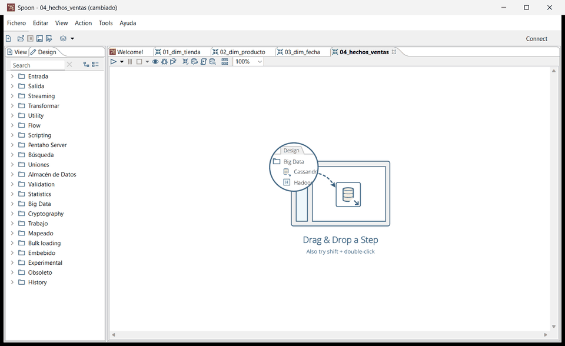
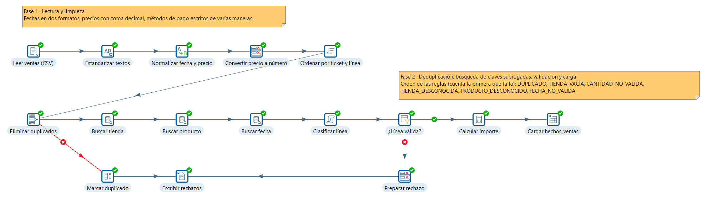
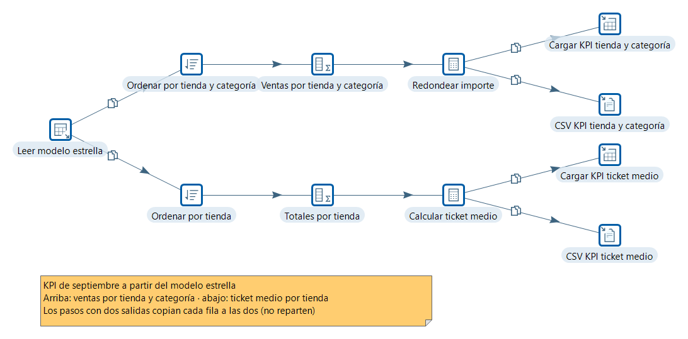
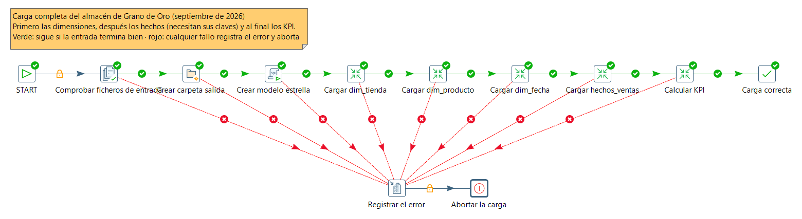
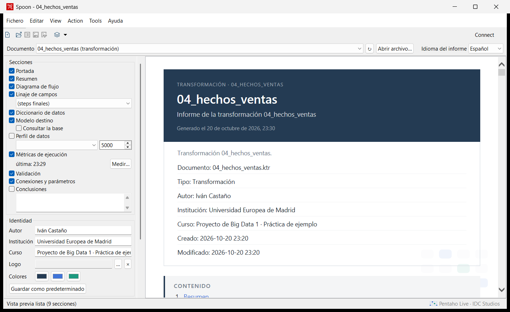
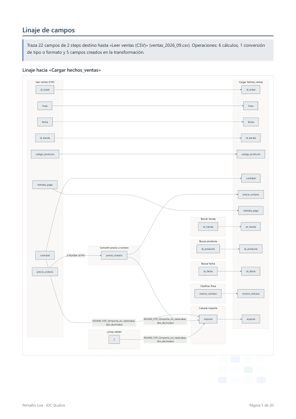
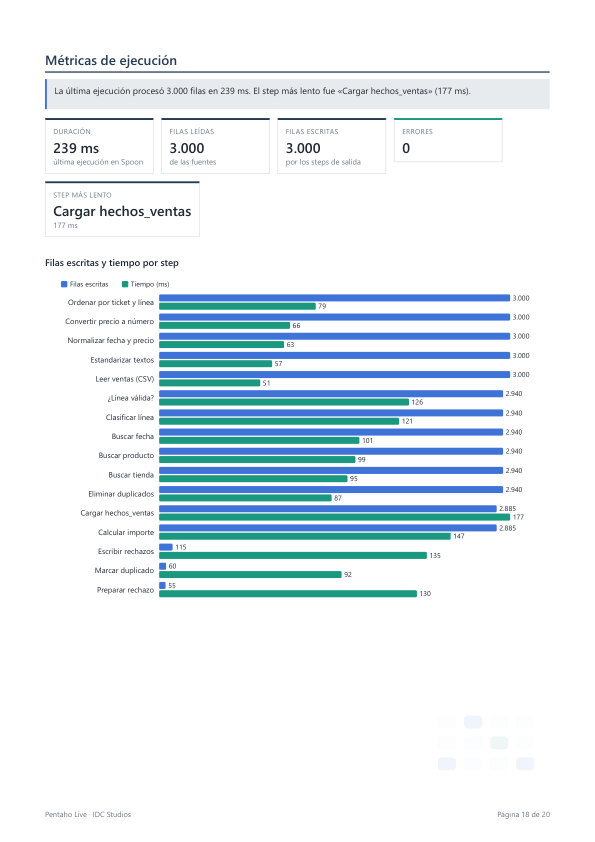
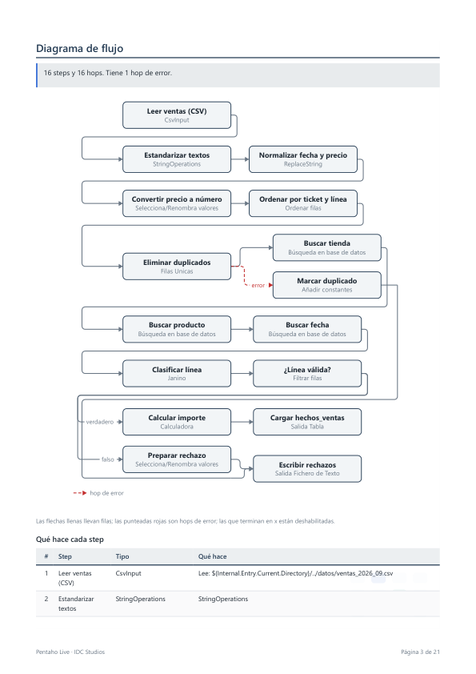
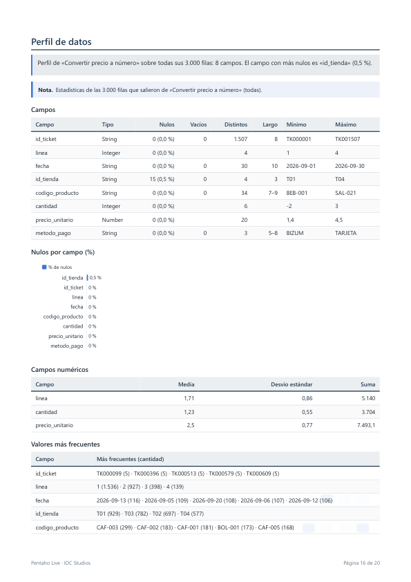

# Ejemplo · «Grano de Oro», una práctica de ETL completa

> **In English.** A university-style ETL assignment used to show what Pentaho Live does. «Grano de
> Oro» is a fictitious chain of four coffee shops in Madrid; the task is to load a month of
> point-of-sale data (CSV), a product catalogue (Excel) and the shop list (nested JSON) into a SQLite
> star schema, cleaning and validating along the way, and to compute two KPIs. The data generator
> injects known amounts of errors, so the expected result is exact. `solucion-referencia/` is a
> working solution written as `.ktr`/`.kjb` files and verified with Kitchen; the live demo has Claude
> build the same ETL on the Spoon canvas through the MCP server, and the Reports tab documents it.
> `pack-correccion/` turns it into a graded exercise for the Pentaho Live grader, with four sample
> submissions. Everything in this folder is in Spanish.

Esta carpeta es un ejercicio de ETL de los que se ponen en una asignatura de Big Data o Ingeniería
de Datos, preparado para enseñar Pentaho Live con algo realista: tres fuentes en tres formatos,
datos sucios de verdad, un modelo en estrella, rechazos con motivo, KPI y un job con camino de error.

Como los errores de los datos se inyectan en cantidades conocidas, **el resultado esperado es
exacto**: cualquier solución (la de referencia, la que Claude construye en directo o la de un
alumno) se comprueba al número con un solo comando.

## Qué hay

```
ejemplo/
├── enunciado.md                 el ejercicio: contexto, datos, qué se pide, entregables y rúbrica
├── guion-demo.md                cómo enseñarlo en clase: pasos, mensajes para Claude y plan B
├── generar_datos.py             genera datos/ (solo biblioteca estándar, semilla fija)
├── comprobar_resultados.py      compara la salida de una ETL con el resultado esperado
├── datos/
│   ├── ventas_2026_09.csv       3000 líneas de ticket (CSV con errores inyectados)
│   ├── productos.xlsx           catálogo de 28 productos (Excel, texto sin estandarizar)
│   ├── tiendas.json             las 4 tiendas (JSON anidado)
│   ├── LEEME.md                 los ficheros, los errores inyectados y el RESULTADO ESPERADO
│   └── resultado_esperado.json  lo mismo, para comprobar_resultados.py
├── solucion-referencia/
│   ├── job_carga_dw.kjb         orquesta todo, con camino de éxito y de error
│   ├── 01_dim_tienda.ktr        JSON → dim_tienda
│   ├── 02_dim_producto.ktr      Excel → dim_producto
│   ├── 03_dim_fecha.ktr         genera los 30 días de septiembre → dim_fecha
│   ├── 04_hechos_ventas.ktr     CSV → limpieza, duplicados, claves, validación → hechos y rechazos
│   ├── 05_kpi_ventas.ktr        modelo estrella → KPI (tabla y CSV)
│   ├── 06_kpi_desde_ficheros.ktr  el KPI por tienda y categoría en una sola transformación (la del corrector)
│   └── RESULTADOS.md            los números comprobados de una ejecución con Kitchen
├── pack-correccion/             el ejercicio para el corrector de Pentaho Live (ver abajo)
├── pack-correccion-alumnos.zip  su copia para alumnos, sin la solución ni el caso oculto
├── entregas-ejemplo/            cuatro entregas con errores típicos, para probar el corrector
├── construido-en-vivo/          la misma ETL, construida por el MCP dentro de Spoon (ver abajo)
├── informes/                    los informes que generó la pestaña Informes (PDF, PowerPoint, HTML, Markdown)
├── capturas/                    el GIF de la construcción, el lienzo de cada transformación y páginas del informe
├── herramientas/                los scripts que repiten la construcción en vivo y los informes, y el que
│                                genera los datos del caso oculto del corrector
└── salida/                      lo que genera la ETL (no se versiona)
```

| Lo que el enunciado pide | Dónde está en la solución de referencia |
|---|---|
| Fechas en dos formatos, coma decimal, mayúsculas y espacios | `04` «Estandarizar textos», «Normalizar fecha y precio», «Convertir precio a número»; `02` «Estandarizar textos» |
| Deduplicación | `04` «Ordenar por ticket y línea» + «Eliminar duplicados»; las copias salen por el hop de error hacia «Marcar duplicado» |
| Validación con rechazos y motivo | `04` «Clasificar línea» + «¿Línea válida?» → `salida/rechazos_ventas.csv` |
| Búsqueda de claves subrogadas | `04` «Buscar tienda», «Buscar producto», «Buscar fecha» |
| Modelo estrella en SQLite | job «Crear modelo estrella» y las cuatro cargas |
| KPI | `05`: ventas por tienda y categoría, ticket medio por tienda |
| Job con éxito y fallo | `job_carga_dw.kjb`: hops verdes en cadena; cualquier fallo → «Registrar el error» → «Abortar la carga» |
| Documentación | la pestaña Informes de Pentaho Live (abajo) |

## Regenerar los datos

```bash
python generar_datos.py
```

Python 3.8 o posterior, sin paquetes externos. La semilla es fija, así que vuelve a escribir
exactamente los mismos ficheros; si se cambia algún parámetro del generador, `datos/LEEME.md` y
`datos/resultado_esperado.json` se reescriben con los números nuevos.

## Ejecutar la solución de referencia

Con PDI 9.4 y PowerShell (cambia la ruta de `data-integration` por la tuya):

```powershell
Remove-Item Env:NoDefaultCurrentDirectoryInExePath -ErrorAction SilentlyContinue
$pdi = 'C:\ruta\a\data-integration'
& cmd.exe /c call "$pdi\Kitchen.bat" "/file:$PWD\solucion-referencia\job_carga_dw.kjb" /level:Basic
$LASTEXITCODE   # 0 = la carga terminó bien
python comprobar_resultados.py
```

También sirve el script de los ejemplos de la skill, que hace lo mismo y usa un `KETTLE_HOME`
aparte para no tocar tu `~/.kettle`:

```powershell
..\claude\skills\pentaho-etl\manual\ejemplos\correr.ps1 solucion-referencia\job_carga_dw.kjb -PdiHome 'C:\ruta\a\data-integration'
```

El job crea `salida/` con el almacén `grano_de_oro_dw.sqlite`, `rechazos_ventas.csv` y los dos CSV
de KPI. Se puede ejecutar las veces que haga falta: borra y vuelve a crear las tablas cada vez.
Las transformaciones también se pueden abrir y ejecutar una a una en Spoon, siempre después de
haber ejecutado el job al menos una vez (el job es quien crea las tablas).

Los números de una ejecución real están en
[`solucion-referencia/RESULTADOS.md`](solucion-referencia/RESULTADOS.md).

## Cómo se hizo la solución de referencia

La escribió Claude con la skill `pentaho-etl` **en modo archivo**, es decir, escribiendo el XML de
los `.ktr` y el `.kjb` sin Spoon abierto, y se dio por buena cuando Kitchen la ejecutó sin errores
y `comprobar_resultados.py` cuadró todas las comprobaciones. No es la única solución posible: el
enunciado evalúa el resultado, no que los pasos sean exactamente estos.

Al abrirla después en Spoon, la verificación («Acción › Verificar», la herramienta `validate`) daba dos
avisos que no eran errores al ejecutar, sino limitaciones de la verificación de PDI 9.4. Se rediseñaron
esos dos puntos para que todo valide limpio:

- **JSON Input** leyendo un fichero sin steps antes siempre da «not expecting nor reading any input». Ahora
  `01` recibe el nombre del fichero desde «Localizar tiendas.json» (Get file names).
- **Los campos que añade un hop de error** no cuentan al verificar, así que «Escribir rechazos» parecía
  recibir filas con distinto número de campos. Ahora las copias pasan por «Marcar duplicado» (Add
  constants), que les pone `motivo_rechazo = DUPLICADO`.

## La demo en directo

En la demo, Claude construye la ETL **dentro de Spoon**, con las herramientas del servidor MCP de
Pentaho Live: los nodos aparecen en el lienzo uno a uno, ya conectados y colocados.



[`construido-en-vivo/`](construido-en-vivo/) es el resultado de una de esas construcciones, hecha para
preparar este ejemplo. El MCP armó las cinco transformaciones y el job en unos **40 segundos**:
`build_steps` para los steps y sus hops, `set_error_handling` para el hop de error, `add_note` para las
notas y `add_entry` + `connect_entries` para el job. Copió la configuración de cada step de la
solución de referencia, para que el resultado sea comparable. Después, en el mismo Spoon:

- las cinco transformaciones **validan sin errores ni avisos**;
- el job termina con las diez entradas en verde;
- `comprobar_resultados.py` da **«Las 29 comprobaciones cuadran»**: 2.885 hechos y 115 rechazos.

[`herramientas/construir_en_vivo.py`](herramientas/construir_en_vivo.py) repite esa construcción con
Spoon abierto. Sirve de plan B en clase y es lo que se grabó para el GIF.

| Transformación | Lienzo (después de ejecutar) |
|---|---|
| `04_hechos_ventas` |  |
| `05_kpi_ventas` |  |
| `job_carga_dw` |  |
| `01`, `02`, `03` | [01](capturas/lienzo_01_dim_tienda.png) · [02](capturas/lienzo_02_dim_producto.png) · [03](capturas/lienzo_03_dim_fecha.png) |

Para presentarlo en directo, con los mensajes listos para Claude y qué enseñar en cada momento, está el
[guion de la demo](guion-demo.md).

## Corregir entregas con el corrector

[`pack-correccion/`](pack-correccion/) convierte la práctica en un ejercicio que corrige el corrector de
Pentaho Live: el alumno entrega una transformación que calcula las ventas por tienda y categoría desde los tres
ficheros, y el corrector la ejecuta con estos datos y con un caso oculto, la compara con la tabla de
`datos/resultado_esperado.json` y pone la nota con una rúbrica. Las cuatro entregas de
[`entregas-ejemplo/`](entregas-ejemplo/) tienen los errores más habituales de esta práctica y sacan notas
distintas, cada una con su pista:

| Entrega | Error | Nota |
|---|---|---:|
| `lucia_rutas_absolutas` | rutas de su ordenador (`C:\Users\lucia\Escritorio\…`) | 9,5 |
| `marcos_sin_quitar_duplicados` | no quita las 60 líneas repetidas | 5,3 |
| `nerea_decimal_vacio` | lee el precio sin símbolo decimal: con `es_ES`, `2.50` vale 250 | 6,0 |
| `oscar_group_by_sin_ordenar` | Group by sin Sort rows delante | 5,0 |

Cómo lo usa un docente (en Spoon, en la perspectiva Corrector, o pidiéndoselo a Claude) y cómo se crea un pack
así: [`pack-correccion/README.md`](pack-correccion/README.md). Lo que escribió el corrector con esas entregas
(planilla, informe del curso y la devolución de cada alumno) está en
[`informes/correccion/`](informes/correccion/).

## El informe que genera Pentaho Live

La pestaña **Informes** de Spoon documenta una transformación o un job sin escribir nada: portada con
autor, institución y curso, resumen, diagrama (la imagen real del lienzo y el flujo en Mermaid),
linaje de campos, diccionario de datos, modelo destino, perfil de los datos, métricas de la última
ejecución, validación y conexiones. Exporta a HTML, PDF, Markdown y PowerPoint.



Los de este ejemplo los pidió Claude por el MCP (`build_report`). Las conclusiones las escribió a partir
de los datos de la ejecución (`get_report_data`) y salen marcadas como asistidas por IA:

| Informe | PDF | PowerPoint | HTML | Markdown |
|---|---|---|---|---|
| Carga de hechos de ventas (`04_hechos_ventas`) | [PDF, 20 págs.](informes/04_hechos_ventas.pdf) | [PPTX](informes/04_hechos_ventas.pptx) | [interactivo](informes/04_hechos_ventas.html) · [ligero](informes/04_hechos_ventas.light.html) | [MD](informes/04_hechos_ventas.md) |
| Job de carga del modelo estrella (`job_carga_dw`) | [PDF](informes/job_carga_dw.pdf) | [PPTX](informes/job_carga_dw.pptx) | [ligero](informes/job_carga_dw.light.html) | [MD](informes/job_carga_dw.md) |

| Linaje de campos | Métricas de ejecución |
|---|---|
|  |  |
| **Diagrama de flujo** | **Perfil de datos** |
|  |  |

[`herramientas/informes_ejemplo.py`](herramientas/informes_ejemplo.py) abre en Spoon los ficheros de
`construido-en-vivo/`, ejecuta el job y genera estos mismos informes.
