# Carga de hechos de ventas · Grano de Oro

**Transformación · 04_hechos_ventas**  
Informe de la transformación 04_hechos_ventas  
*Generado el 21 de octubre de 2026, 16:11*

Transformación 04_hechos_ventas.

- Documento: 04_hechos_ventas.ktr
- Tipo: Transformación
- Autor: Iván Castaño
- Institución: Universidad Europea de Madrid
- Curso: Proyecto de Big Data 1 · Práctica de ejemplo
- Creado: 2026-10-20 23:20
- Modificado: 2026-10-20 23:20

## Resumen

*Lee 1 archivo (ventas_2026_09.csv), calcula, selecciona campos, ordena, quita duplicados, busca valores, agrega constantes, filtra y separa las filas con error, escribe 1 archivo (rechazos_ventas.csv), y escribe en 1 tabla (hechos_ventas). 16 steps y 16 hops.*  

Esta transformación carga la tabla de hechos del modelo estrella de **Grano de Oro** a partir del fichero de ventas de septiembre de 2026. En la última ejecución leyó **3.000 líneas**: 60 eran duplicados exactos, que salen por el hop de error de «Eliminar duplicados» y reciben el motivo DUPLICADO en «Marcar duplicado»; 55 no superaron las reglas de «¿Línea válida?», y las **2.885 restantes** se cargaron en \`hechos_ventas\`. Las 115 líneas descartadas quedan en \`rechazos_ventas.csv\` con su motivo, de modo que 2.885 + 115 = 3.000: no se pierde ninguna línea.

*Texto redactado con asistencia de IA*  

| Indicador | Valor |
| --- | --- |
| Steps | 16 |
| Hops | 16 |
| Archivos leídos | 1 · ventas_2026_09.csv |
| Archivos escritos | 1 · rechazos_ventas.csv |
| Tablas escritas | 1 · hechos_ventas |
| Conexiones | 1 |

La última ejecución procesó 3.000 filas en 292 ms. El step más lento fue «Cargar hechos_ventas» (206 ms).

### Lo más importante

- **Diagrama de flujo:** 16 steps y 16 hops. Tiene 1 hop de error.
- **Linaje de campos:** Traza 22 campos de 2 steps destino hasta «Leer ventas (CSV)» (ventas_2026_09.csv). Operaciones: 6 cálculos, 1 conversión de tipo o formato y 5 campos creados en la transformación.
- **Diccionario de datos:** 2 salidas finales con 18 campos en total.
- **Modelo destino:** Escribe en 1 tabla (hechos_ventas) por la conexión dw_grano_de_oro: 9 columnas. Las claves y los tipos salen de los steps, sin consultar la base.
- **Perfil de datos:** Perfil de «Convertir precio a número» sobre todas sus 3.000 filas: 8 campos. El campo con más nulos es «id_tienda» (0,5 %).
- **Validación:** Sin errores ni advertencias.
- **Conexiones y parámetros:** 1 conexión y 0 parámetros.

## Diagrama de flujo

*16 steps y 16 hops. Tiene 1 hop de error.*  

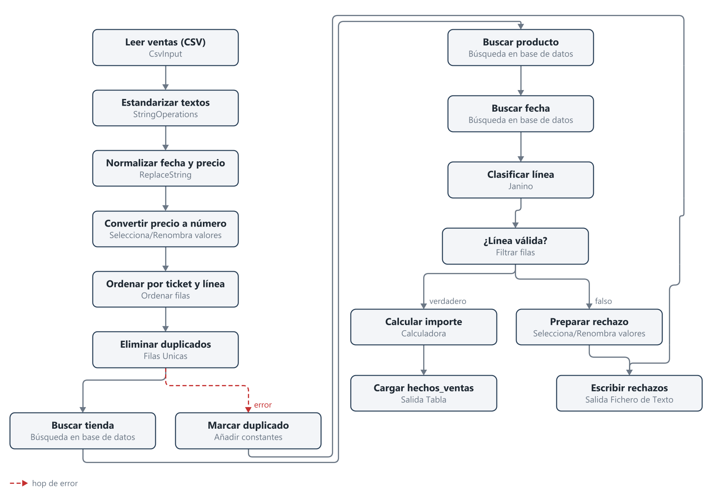

[Captura del lienzo de Spoon (muy ancha: ábrela para verla a tamaño real)](04_hechos_ventas_archivos/lienzo.png)

Código Mermaid del diagrama (para Obsidian y GitHub)

```mermaid
flowchart LR
  s1["Leer ventas (CSV)<br/>CsvInput"]
  s2["Estandarizar textos<br/>StringOperations"]
  s3["Normalizar fecha y precio<br/>ReplaceString"]
  s4["Convertir precio a número<br/>Selecciona/Renombra valores"]
  s5["Ordenar por ticket y línea<br/>Ordenar filas"]
  s6["Eliminar duplicados<br/>Filas Unicas"]
  s7["Buscar tienda<br/>Búsqueda en base de datos"]
  s8["Buscar producto<br/>Búsqueda en base de datos"]
  s9["Buscar fecha<br/>Búsqueda en base de datos"]
  s10["Clasificar línea<br/>Janino"]
  s11["Marcar duplicado<br/>Añadir constantes"]
  s12["¿Línea válida?<br/>Filtrar filas"]
  s13["Calcular importe<br/>Calculadora"]
  s14["Cargar hechos_ventas<br/>Salida Tabla"]
  s15["Preparar rechazo<br/>Selecciona/Renombra valores"]
  s16["Escribir rechazos<br/>Salida Fichero de Texto"]
  s1 --> s2
  s2 --> s3
  s3 --> s4
  s4 --> s5
  s5 --> s6
  s6 --> s7
  s7 --> s8
  s8 --> s9
  s9 --> s10
  s10 --> s12
  s12 -->|"verdadero"| s13
  s13 --> s14
  s12 -->|"falso"| s15
  s11 --> s16
  s6 -.->|"error"| s11
  s15 --> s16
  linkStyle 14 stroke:#d33,color:#d33
```

*Las flechas llenas llevan filas; las punteadas rojas son hops de error; las que terminan en x están deshabilitadas.*  

### Qué hace cada step

| \# | Step | Tipo | Qué hace |
| ---: | --- | --- | --- |
| 1 | Leer ventas (CSV) | CsvInput | Lee: \${Internal.Entry.Current.Directory}/../datos/ventas_2026_09.csv |
| 2 | Estandarizar textos | StringOperations | StringOperations |
| 3 | Normalizar fecha y precio | ReplaceString | ReplaceString |
| 4 | Convertir precio a número | Selecciona/Renombra valores (SelectValues) | Seleccionar o eliminar campos de una fila. Opcionalmente, se puede establecer la meta-información del campo: tipo, longitud y precisión. |
| 5 | Ordenar por ticket y línea | Ordenar filas (SortRows) | Ordena por: id_ticket, linea |
| 6 | Eliminar duplicados | Filas Unicas (Unique) | Eliminar filas duplicadas y dejar solo ocurrencias únicas. Esto funciona solo con entradas ordenadas. Si la entrada no esta ordenada, solo se hace correctamente las entradas duplicadas consecutivas. |
| 7 | Buscar tienda | Búsqueda en base de datos (DBLookup) | Obtener valores de una base de datos utilizando campos |
| 8 | Buscar producto | Búsqueda en base de datos (DBLookup) | Obtener valores de una base de datos utilizando campos |
| 9 | Buscar fecha | Búsqueda en base de datos (DBLookup) | Obtener valores de una base de datos utilizando campos |
| 10 | Clasificar línea | Janino | Janino |
| 11 | Marcar duplicado | Añadir constantes (Constant) | Añadir uno o más constantes a las filas de entrada |
| 12 | ¿Línea válida? | Filtrar filas (FilterRows) | Condición: motivo_rechazo IS NULL |
| 13 | Calcular importe | Calculadora (Calculator) | Crear nuevos campos a partir de cálculos sencillos |
| 14 | Cargar hechos_ventas | Salida Tabla (TableOutput) | Tabla: hechos_ventas; Conexión: dw_grano_de_oro |
| 15 | Preparar rechazo | Selecciona/Renombra valores (SelectValues) | Seleccionar o eliminar campos de una fila. Opcionalmente, se puede establecer la meta-información del campo: tipo, longitud y precisión. |
| 16 | Escribir rechazos | Salida Fichero de Texto (TextFileOutput) | Escribe: \${Internal.Entry.Current.Directory}/../salida/rechazos_ventas.csv |

## Linaje de campos

*Traza 22 campos de 2 steps destino hasta «Leer ventas (CSV)» (ventas_2026_09.csv). Operaciones: 6 cálculos, 1 conversión de tipo o formato y 5 campos creados en la transformación.*  

**Para qué sirve:** muestra de dónde sale cada campo que escribe la transformación y qué le pasa por el camino. Sirve para saber qué se rompe si cambias una columna de origen (análisis de impacto), para encontrar en qué step se estropea un valor que sale mal y para documentar el proceso (auditorías y normativa).

### Linaje hacia «Cargar hechos_ventas»

*Parte 1 de 3*  

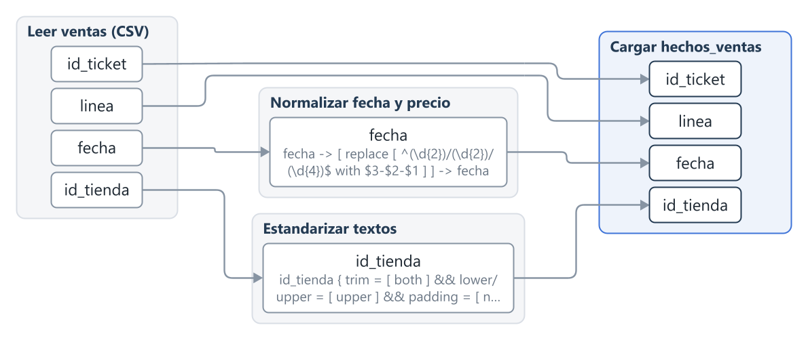

*Parte 2 de 3*  

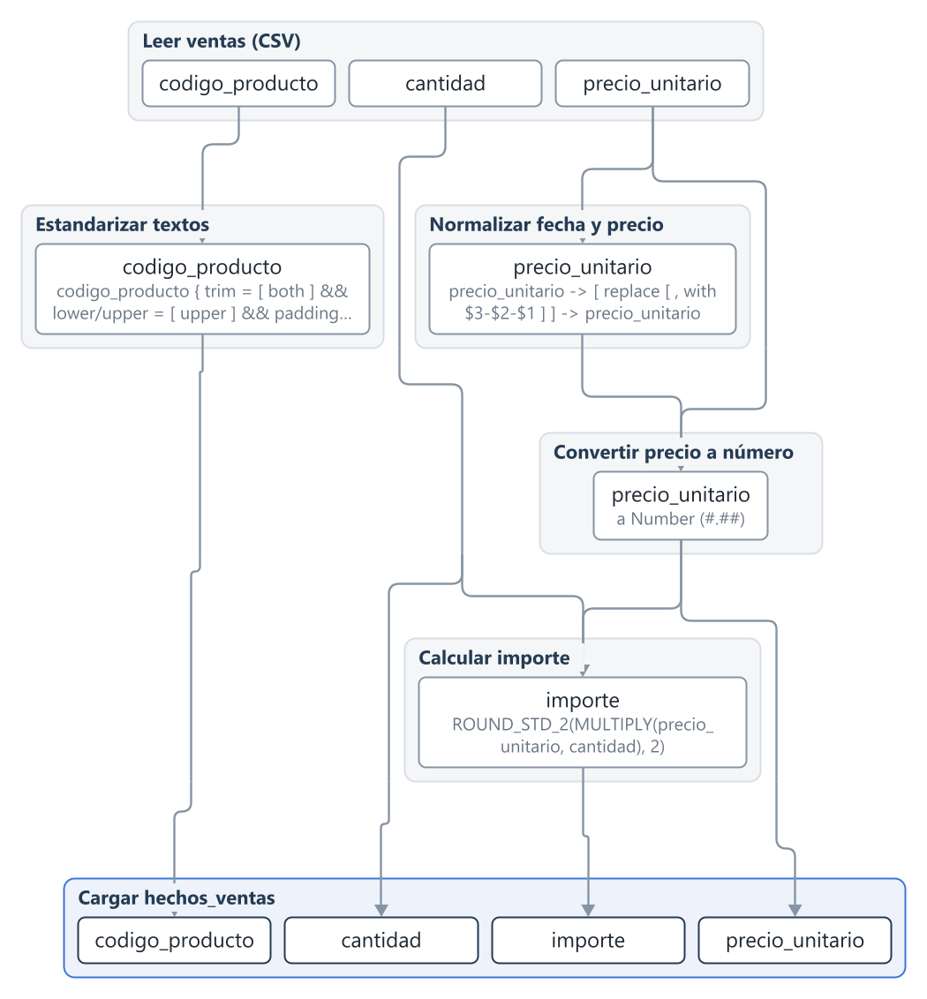

*Parte 3 de 3*  

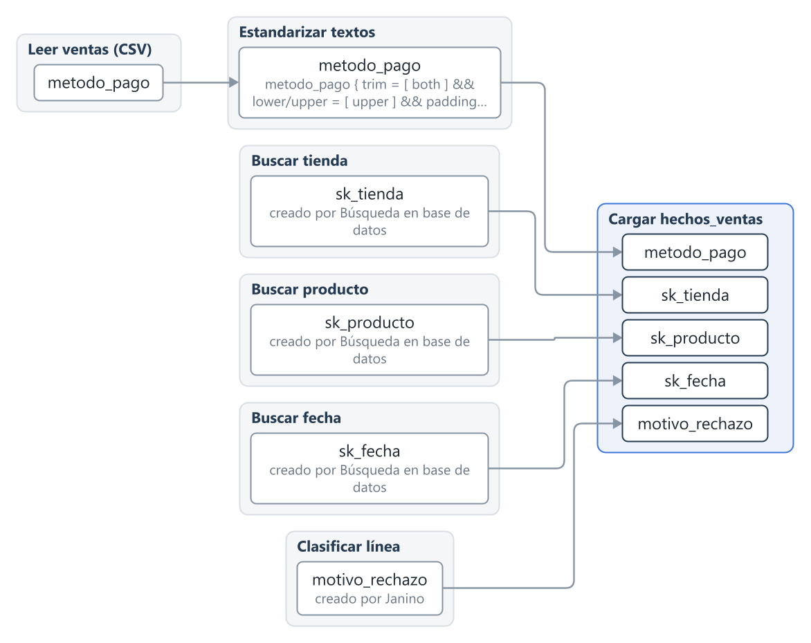

Código Mermaid del diagrama (para Obsidian y GitHub)

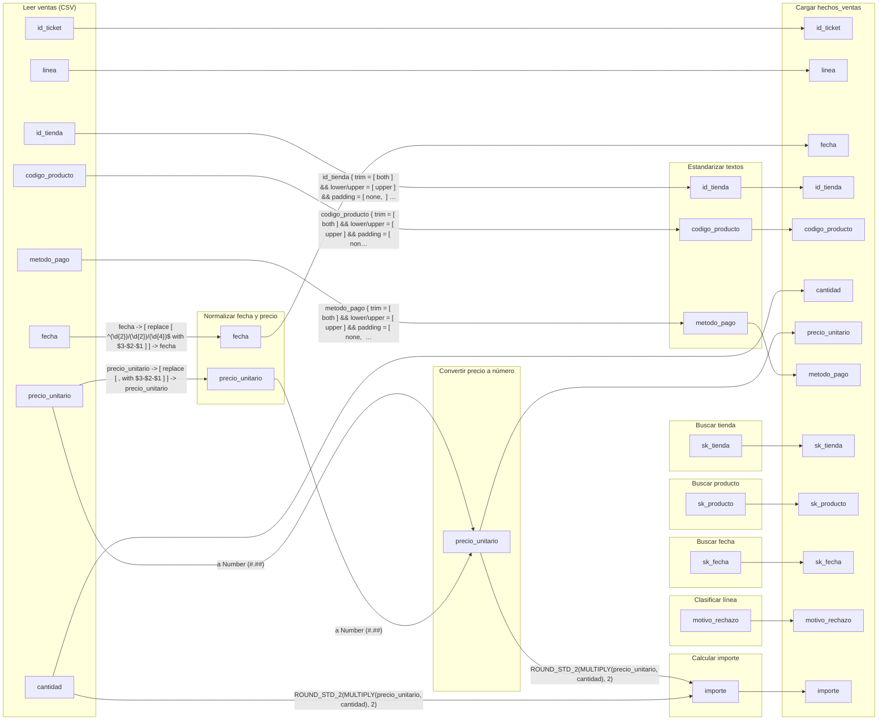

### Campos de «Cargar hechos_ventas»

| Campo | Tipo | Viene de | Transformaciones |
| --- | --- | --- | --- |
| id_ticket | String | Leer ventas (CSV) (ventas_2026_09.csv): id_ticket | sin cambios |
| linea | Integer | Leer ventas (CSV) (ventas_2026_09.csv): linea | sin cambios |
| fecha | String | Leer ventas (CSV) (ventas_2026_09.csv): fecha | fecha -\> \[ replace \[ ^(\\d{2})/(\\d{2})/(\\d{4})\$ with \$3-\$2-\$1 \] \] -\> fecha en «Normalizar fecha y precio» |
| id_tienda | String | Leer ventas (CSV) (ventas_2026_09.csv): id_tienda | id_tienda { trim = \[ both \] \&\& lower/upper = \[ upper \] \&\& padding = \[ none,  \] \&\& cap = \[ no \] \&\& maskXML = \[ none \] \&\& digits = \[ none \] \&\& remove = \[ none \] } -\> id_tienda en «Estandarizar textos» |
| codigo_producto | String | Leer ventas (CSV) (ventas_2026_09.csv): codigo_producto | codigo_producto { trim = \[ both \] \&\& lower/upper = \[ upper \] \&\& padding = \[ none,  \] \&\& cap = \[ no \] \&\& maskXML = \[ none \] \&\& digits = \[ none \] \&\& remove = \[ none \] } -\> codigo_producto en «Estandarizar textos» |
| cantidad | Integer | Leer ventas (CSV) (ventas_2026_09.csv): cantidad | sin cambios |
| precio_unitario | Number | Leer ventas (CSV) (ventas_2026_09.csv): precio_unitario | precio_unitario -\> \[ replace \[ , with \$3-\$2-\$1 \] \] -\> precio_unitario en «Normalizar fecha y precio» → a Number (\#.\#\#) en «Convertir precio a número» |
| metodo_pago | String | Leer ventas (CSV) (ventas_2026_09.csv): metodo_pago | metodo_pago { trim = \[ both \] \&\& lower/upper = \[ upper \] \&\& padding = \[ none,  \] \&\& cap = \[ no \] \&\& maskXML = \[ none \] \&\& digits = \[ none \] \&\& remove = \[ none \] } -\> metodo_pago en «Estandarizar textos» |
| sk_tienda | Integer | Buscar tienda: sk_tienda (creado) | creado por Búsqueda en base de datos en «Buscar tienda» |
| sk_producto | Integer | Buscar producto: sk_producto (creado) | creado por Búsqueda en base de datos en «Buscar producto» |
| sk_fecha | Integer | Buscar fecha: sk_fecha (creado) | creado por Búsqueda en base de datos en «Buscar fecha» |
| motivo_rechazo | String | Clasificar línea: motivo_rechazo (creado) | creado por Janino en «Clasificar línea» |
| importe | Number | Leer ventas (CSV) (ventas_2026_09.csv): cantidad, precio_unitario | ROUND_STD_2(MULTIPLY(precio_unitario, cantidad), 2) en «Calcular importe»; a Number (\#.\#\#) en «Convertir precio a número» → ROUND_STD_2(MULTIPLY(precio_unitario, cantidad), 2) en «Calcular importe» |

*Motor: metaverse de Pentaho y motor propio de Pentaho Live; metaverse no pudo trazar importe, así que esos campos los traza el motor propio.*  

### Linaje hacia «Escribir rechazos»

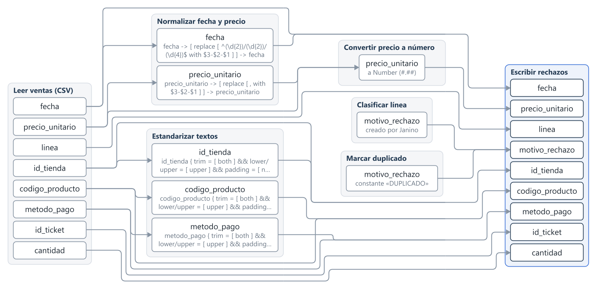

Código Mermaid del diagrama (para Obsidian y GitHub)

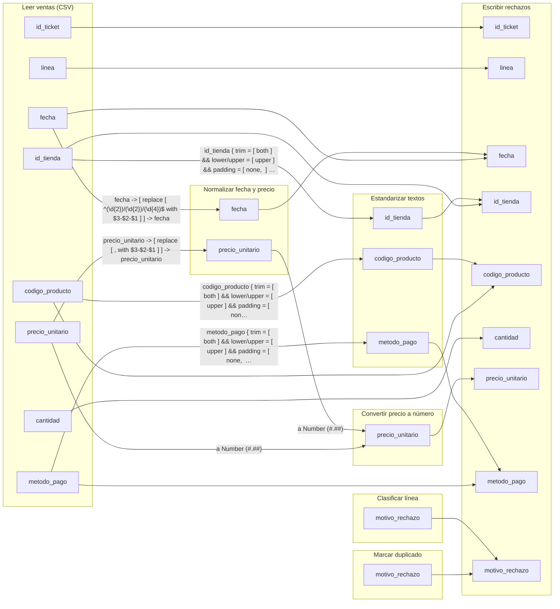

### Campos de «Escribir rechazos»

| Campo | Tipo | Viene de | Transformaciones |
| --- | --- | --- | --- |
| id_ticket | String | Leer ventas (CSV) (ventas_2026_09.csv): id_ticket | sin cambios |
| linea | Integer | Leer ventas (CSV) (ventas_2026_09.csv): linea | sin cambios |
| fecha | String | Leer ventas (CSV) (ventas_2026_09.csv): fecha | fecha -\> \[ replace \[ ^(\\d{2})/(\\d{2})/(\\d{4})\$ with \$3-\$2-\$1 \] \] -\> fecha en «Normalizar fecha y precio» |
| id_tienda | String | Leer ventas (CSV) (ventas_2026_09.csv): id_tienda | id_tienda { trim = \[ both \] \&\& lower/upper = \[ upper \] \&\& padding = \[ none,  \] \&\& cap = \[ no \] \&\& maskXML = \[ none \] \&\& digits = \[ none \] \&\& remove = \[ none \] } -\> id_tienda en «Estandarizar textos» |
| codigo_producto | String | Leer ventas (CSV) (ventas_2026_09.csv): codigo_producto | codigo_producto { trim = \[ both \] \&\& lower/upper = \[ upper \] \&\& padding = \[ none,  \] \&\& cap = \[ no \] \&\& maskXML = \[ none \] \&\& digits = \[ none \] \&\& remove = \[ none \] } -\> codigo_producto en «Estandarizar textos» |
| cantidad | Integer | Leer ventas (CSV) (ventas_2026_09.csv): cantidad | sin cambios |
| precio_unitario | Number | Leer ventas (CSV) (ventas_2026_09.csv): precio_unitario | precio_unitario -\> \[ replace \[ , with \$3-\$2-\$1 \] \] -\> precio_unitario en «Normalizar fecha y precio» → a Number (\#.\#\#) en «Convertir precio a número»; a Number (\#.\#\#) en «Convertir precio a número» |
| metodo_pago | String | Leer ventas (CSV) (ventas_2026_09.csv): metodo_pago | metodo_pago { trim = \[ both \] \&\& lower/upper = \[ upper \] \&\& padding = \[ none,  \] \&\& cap = \[ no \] \&\& maskXML = \[ none \] \&\& digits = \[ none \] \&\& remove = \[ none \] } -\> metodo_pago en «Estandarizar textos» |
| motivo_rechazo | String | Clasificar línea: motivo_rechazo (creado); Marcar duplicado: motivo_rechazo (creado) | creado por Janino en «Clasificar línea»; constante «DUPLICADO» en «Marcar duplicado» |

*Motor: metaverse de Pentaho y motor propio de Pentaho Live.*  

## Diccionario de datos

*2 salidas finales con 18 campos en total.*  

### Salida final: Cargar hechos_ventas

| Campo | Tipo | Largo | Precisión | Máscara | Origen | Comentario |
| --- | --- | ---: | ---: | --- | --- | --- |
| id_ticket | String |  |  |  | Leer ventas (CSV) |  |
| linea | Integer |  | 0 | \# | Leer ventas (CSV) |  |
| sk_fecha | Integer | 9 | 0 | \#\#\#\#0;-\#\#\#\#0 | Buscar fecha | sk_fecha |
| sk_tienda | Integer | 9 | 0 | \#\#\#\#0;-\#\#\#\#0 | Buscar tienda | sk_tienda |
| sk_producto | Integer | 9 | 0 | \#\#\#\#0;-\#\#\#\#0 | Buscar producto | sk_producto |
| cantidad | Integer |  | 0 | \# | Leer ventas (CSV) |  |
| precio_unitario | Number |  |  | \#.\#\# | Convertir precio a número |  |
| importe | Number |  | 2 |  | Calcular importe | ROUND_STD_2 |
| metodo_pago | String |  |  |  | Leer ventas (CSV) |  |

*Nombres, orden, formato y largo como los escribe «Cargar hechos_ventas»; el tipo, el origen y el comentario vienen del flujo. Los largos vacíos significan «sin límite».*  

### Salida final: Escribir rechazos

| Campo | Tipo | Largo | Precisión | Máscara | Origen | Comentario |
| --- | --- | ---: | ---: | --- | --- | --- |
| id_ticket | String |  |  |  | Leer ventas (CSV) |  |
| linea | Integer |  | 0 | 0 | Leer ventas (CSV) |  |
| fecha | String |  |  |  | Leer ventas (CSV) |  |
| id_tienda | String |  |  |  | Leer ventas (CSV) |  |
| codigo_producto | String |  |  |  | Leer ventas (CSV) |  |
| cantidad | Integer |  | 0 | 0 | Leer ventas (CSV) |  |
| precio_unitario | Number |  |  | 0.00 | Convertir precio a número |  |
| metodo_pago | String |  |  |  | Leer ventas (CSV) |  |
| motivo_rechazo | String |  |  |  | Marcar duplicado |  |

*Nombres, orden, formato y largo como los escribe «Escribir rechazos»; el tipo, el origen y el comentario vienen del flujo. Los largos vacíos significan «sin límite».*  

**Anexo: campos de los demás steps**

### Leer ventas (CSV)

| Campo | Tipo | Largo | Precisión | Origen |
| --- | --- | ---: | ---: | --- |
| id_ticket | String |  |  | Leer ventas (CSV) |
| linea | Integer |  | 0 | Leer ventas (CSV) |
| fecha | String |  |  | Leer ventas (CSV) |
| id_tienda | String |  |  | Leer ventas (CSV) |
| codigo_producto | String |  |  | Leer ventas (CSV) |
| cantidad | Integer |  | 0 | Leer ventas (CSV) |
| precio_unitario | String |  |  | Leer ventas (CSV) |
| metodo_pago | String |  |  | Leer ventas (CSV) |

### Estandarizar textos

| Campo | Tipo | Largo | Precisión | Origen |
| --- | --- | ---: | ---: | --- |
| id_ticket | String |  |  | Leer ventas (CSV) |
| linea | Integer |  | 0 | Leer ventas (CSV) |
| fecha | String |  |  | Leer ventas (CSV) |
| id_tienda | String |  |  | Leer ventas (CSV) |
| codigo_producto | String |  |  | Leer ventas (CSV) |
| cantidad | Integer |  | 0 | Leer ventas (CSV) |
| precio_unitario | String |  |  | Leer ventas (CSV) |
| metodo_pago | String |  |  | Leer ventas (CSV) |

### Normalizar fecha y precio

| Campo | Tipo | Largo | Precisión | Origen |
| --- | --- | ---: | ---: | --- |
| id_ticket | String |  |  | Leer ventas (CSV) |
| linea | Integer |  | 0 | Leer ventas (CSV) |
| fecha | String |  |  | Leer ventas (CSV) |
| id_tienda | String |  |  | Leer ventas (CSV) |
| codigo_producto | String |  |  | Leer ventas (CSV) |
| cantidad | Integer |  | 0 | Leer ventas (CSV) |
| precio_unitario | String |  |  | Leer ventas (CSV) |
| metodo_pago | String |  |  | Leer ventas (CSV) |

### Convertir precio a número

| Campo | Tipo | Largo | Precisión | Origen |
| --- | --- | ---: | ---: | --- |
| id_ticket | String |  |  | Leer ventas (CSV) |
| linea | Integer |  | 0 | Leer ventas (CSV) |
| fecha | String |  |  | Leer ventas (CSV) |
| id_tienda | String |  |  | Leer ventas (CSV) |
| codigo_producto | String |  |  | Leer ventas (CSV) |
| cantidad | Integer |  | 0 | Leer ventas (CSV) |
| precio_unitario | Number |  |  | Convertir precio a número |
| metodo_pago | String |  |  | Leer ventas (CSV) |

### Ordenar por ticket y línea

| Campo | Tipo | Largo | Precisión | Origen |
| --- | --- | ---: | ---: | --- |
| id_ticket | String |  |  | Leer ventas (CSV) |
| linea | Integer |  | 0 | Leer ventas (CSV) |
| fecha | String |  |  | Leer ventas (CSV) |
| id_tienda | String |  |  | Leer ventas (CSV) |
| codigo_producto | String |  |  | Leer ventas (CSV) |
| cantidad | Integer |  | 0 | Leer ventas (CSV) |
| precio_unitario | Number |  |  | Convertir precio a número |
| metodo_pago | String |  |  | Leer ventas (CSV) |

### Eliminar duplicados

| Campo | Tipo | Largo | Precisión | Origen |
| --- | --- | ---: | ---: | --- |
| id_ticket | String |  |  | Leer ventas (CSV) |
| linea | Integer |  | 0 | Leer ventas (CSV) |
| fecha | String |  |  | Leer ventas (CSV) |
| id_tienda | String |  |  | Leer ventas (CSV) |
| codigo_producto | String |  |  | Leer ventas (CSV) |
| cantidad | Integer |  | 0 | Leer ventas (CSV) |
| precio_unitario | Number |  |  | Convertir precio a número |
| metodo_pago | String |  |  | Leer ventas (CSV) |

### Buscar tienda

| Campo | Tipo | Largo | Precisión | Origen |
| --- | --- | ---: | ---: | --- |
| id_ticket | String |  |  | Leer ventas (CSV) |
| linea | Integer |  | 0 | Leer ventas (CSV) |
| fecha | String |  |  | Leer ventas (CSV) |
| id_tienda | String |  |  | Leer ventas (CSV) |
| codigo_producto | String |  |  | Leer ventas (CSV) |
| cantidad | Integer |  | 0 | Leer ventas (CSV) |
| precio_unitario | Number |  |  | Convertir precio a número |
| metodo_pago | String |  |  | Leer ventas (CSV) |
| sk_tienda | Integer | 9 | 0 | Buscar tienda |

### Buscar producto

| Campo | Tipo | Largo | Precisión | Origen |
| --- | --- | ---: | ---: | --- |
| id_ticket | String |  |  | Leer ventas (CSV) |
| linea | Integer |  | 0 | Leer ventas (CSV) |
| fecha | String |  |  | Leer ventas (CSV) |
| id_tienda | String |  |  | Leer ventas (CSV) |
| codigo_producto | String |  |  | Leer ventas (CSV) |
| cantidad | Integer |  | 0 | Leer ventas (CSV) |
| precio_unitario | Number |  |  | Convertir precio a número |
| metodo_pago | String |  |  | Leer ventas (CSV) |
| sk_tienda | Integer | 9 | 0 | Buscar tienda |
| sk_producto | Integer | 9 | 0 | Buscar producto |

### Buscar fecha

| Campo | Tipo | Largo | Precisión | Origen |
| --- | --- | ---: | ---: | --- |
| id_ticket | String |  |  | Leer ventas (CSV) |
| linea | Integer |  | 0 | Leer ventas (CSV) |
| fecha | String |  |  | Leer ventas (CSV) |
| id_tienda | String |  |  | Leer ventas (CSV) |
| codigo_producto | String |  |  | Leer ventas (CSV) |
| cantidad | Integer |  | 0 | Leer ventas (CSV) |
| precio_unitario | Number |  |  | Convertir precio a número |
| metodo_pago | String |  |  | Leer ventas (CSV) |
| sk_tienda | Integer | 9 | 0 | Buscar tienda |
| sk_producto | Integer | 9 | 0 | Buscar producto |
| sk_fecha | Integer | 9 | 0 | Buscar fecha |

### Clasificar línea

| Campo | Tipo | Largo | Precisión | Origen |
| --- | --- | ---: | ---: | --- |
| id_ticket | String |  |  | Leer ventas (CSV) |
| linea | Integer |  | 0 | Leer ventas (CSV) |
| fecha | String |  |  | Leer ventas (CSV) |
| id_tienda | String |  |  | Leer ventas (CSV) |
| codigo_producto | String |  |  | Leer ventas (CSV) |
| cantidad | Integer |  | 0 | Leer ventas (CSV) |
| precio_unitario | Number |  |  | Convertir precio a número |
| metodo_pago | String |  |  | Leer ventas (CSV) |
| sk_tienda | Integer | 9 | 0 | Buscar tienda |
| sk_producto | Integer | 9 | 0 | Buscar producto |
| sk_fecha | Integer | 9 | 0 | Buscar fecha |
| motivo_rechazo | String |  |  | Clasificar línea |

### Marcar duplicado

| Campo | Tipo | Largo | Precisión | Origen |
| --- | --- | ---: | ---: | --- |
| id_ticket | String |  |  | Leer ventas (CSV) |
| linea | Integer |  | 0 | Leer ventas (CSV) |
| fecha | String |  |  | Leer ventas (CSV) |
| id_tienda | String |  |  | Leer ventas (CSV) |
| codigo_producto | String |  |  | Leer ventas (CSV) |
| cantidad | Integer |  | 0 | Leer ventas (CSV) |
| precio_unitario | Number |  |  | Convertir precio a número |
| metodo_pago | String |  |  | Leer ventas (CSV) |
| motivo_rechazo | String |  |  | Marcar duplicado |

### ¿Línea válida?

| Campo | Tipo | Largo | Precisión | Origen |
| --- | --- | ---: | ---: | --- |
| id_ticket | String |  |  | Leer ventas (CSV) |
| linea | Integer |  | 0 | Leer ventas (CSV) |
| fecha | String |  |  | Leer ventas (CSV) |
| id_tienda | String |  |  | Leer ventas (CSV) |
| codigo_producto | String |  |  | Leer ventas (CSV) |
| cantidad | Integer |  | 0 | Leer ventas (CSV) |
| precio_unitario | Number |  |  | Convertir precio a número |
| metodo_pago | String |  |  | Leer ventas (CSV) |
| sk_tienda | Integer | 9 | 0 | Buscar tienda |
| sk_producto | Integer | 9 | 0 | Buscar producto |
| sk_fecha | Integer | 9 | 0 | Buscar fecha |
| motivo_rechazo | String |  |  | Clasificar línea |

### Calcular importe

| Campo | Tipo | Largo | Precisión | Origen |
| --- | --- | ---: | ---: | --- |
| id_ticket | String |  |  | Leer ventas (CSV) |
| linea | Integer |  | 0 | Leer ventas (CSV) |
| fecha | String |  |  | Leer ventas (CSV) |
| id_tienda | String |  |  | Leer ventas (CSV) |
| codigo_producto | String |  |  | Leer ventas (CSV) |
| cantidad | Integer |  | 0 | Leer ventas (CSV) |
| precio_unitario | Number |  |  | Convertir precio a número |
| metodo_pago | String |  |  | Leer ventas (CSV) |
| sk_tienda | Integer | 9 | 0 | Buscar tienda |
| sk_producto | Integer | 9 | 0 | Buscar producto |
| sk_fecha | Integer | 9 | 0 | Buscar fecha |
| motivo_rechazo | String |  |  | Clasificar línea |
| importe | Number |  | 2 | Calcular importe |

### Preparar rechazo

| Campo | Tipo | Largo | Precisión | Origen |
| --- | --- | ---: | ---: | --- |
| id_ticket | String |  |  | Leer ventas (CSV) |
| linea | Integer |  | 0 | Leer ventas (CSV) |
| fecha | String |  |  | Leer ventas (CSV) |
| id_tienda | String |  |  | Leer ventas (CSV) |
| codigo_producto | String |  |  | Leer ventas (CSV) |
| cantidad | Integer |  | 0 | Leer ventas (CSV) |
| precio_unitario | Number |  |  | Convertir precio a número |
| metodo_pago | String |  |  | Leer ventas (CSV) |
| motivo_rechazo | String |  |  | Clasificar línea |

## Modelo destino

*Escribe en 1 tabla (hechos_ventas) por la conexión dw_grano_de_oro: 9 columnas. Las claves y los tipos salen de los steps, sin consultar la base.*  

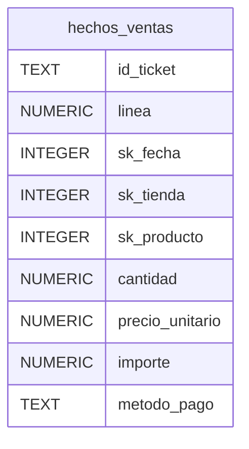

### dw_grano_de_oro › hechos_ventas — Cargar hechos_ventas (Salida a tabla, vacía la tabla)

| Columna | Campo del stream | Tipo Kettle | Tipo SQL (generado) | Clave / uso |
| --- | --- | --- | --- | --- |
| id_ticket | id_ticket | String | TEXT |  |
| linea | linea | Integer | NUMERIC |  |
| sk_fecha | sk_fecha | Integer | INTEGER |  |
| sk_tienda | sk_tienda | Integer | INTEGER |  |
| sk_producto | sk_producto | Integer | INTEGER |  |
| cantidad | cantidad | Integer | NUMERIC |  |
| precio_unitario | precio_unitario | Number | NUMERIC |  |
| importe | importe | Number | NUMERIC |  |
| metodo_pago | metodo_pago | String | TEXT |  |

> [!NOTE]
> No se consultó la base: no se muestran las claves primarias ni foráneas, y los tipos SQL son los que generaría Kettle. Con «Consultar la base» se leen.

## Perfil de datos

*Perfil de «Convertir precio a número» sobre todas sus 3.000 filas: 8 campos. El campo con más nulos es «id_tienda» (0,5 %).*  

> [!NOTE]
> Estadísticas de las 3.000 filas que salieron de «Convertir precio a número» (todas).

### Campos

| Campo | Tipo | Nulos | Vacíos | Distintos | Largo | Mínimo | Máximo |
| --- | --- | ---: | ---: | ---: | ---: | --- | --- |
| id_ticket | String | 0 (0,0 %) | 0 | 1.507 | 8 | TK000001 | TK001507 |
| linea | Integer | 0 (0,0 %) |  | 4 |  | 1 | 4 |
| fecha | String | 0 (0,0 %) | 0 | 30 | 10 | 2026-09-01 | 2026-09-30 |
| id_tienda | String | 15 (0,5 %) | 0 | 4 | 3 | T01 | T04 |
| codigo_producto | String | 0 (0,0 %) | 0 | 34 | 7–9 | BEB-001 | SAL-021 |
| cantidad | Integer | 0 (0,0 %) |  | 6 |  | -2 | 3 |
| precio_unitario | Number | 0 (0,0 %) |  | 20 |  | 1,4 | 4,5 |
| metodo_pago | String | 0 (0,0 %) | 0 | 3 | 5–8 | BIZUM | TARJETA |

### Nulos por campo (%)

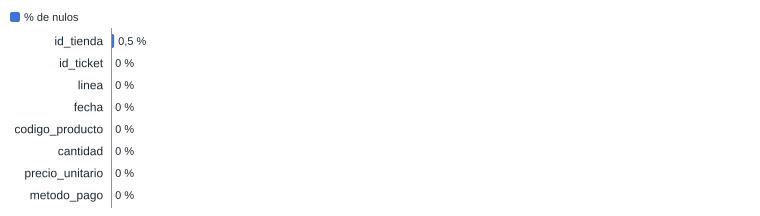

### Campos numéricos

| Campo | Media | Desvío estándar | Suma |
| --- | ---: | ---: | ---: |
| linea | 1,71 | 0,86 | 5.140 |
| cantidad | 1,23 | 0,55 | 3.704 |
| precio_unitario | 2,5 | 0,77 | 7.493,1 |

### Valores más frecuentes

| Campo | Más frecuentes (cantidad) |
| --- | --- |
| id_ticket | TK000099 (5) · TK000396 (5) · TK000513 (5) · TK000579 (5) · TK000609 (5) |
| linea | 1 (1.536) · 2 (927) · 3 (398) · 4 (139) |
| fecha | 2026-09-13 (116) · 2026-09-05 (109) · 2026-09-20 (108) · 2026-09-06 (107) · 2026-09-12 (106) |
| id_tienda | T01 (929) · T03 (782) · T02 (697) · T04 (577) |
| codigo_producto | CAF-003 (299) · CAF-002 (183) · CAF-001 (181) · BOL-001 (173) · CAF-005 (168) |
| cantidad | 1 (2.386) · 2 (456) · 3 (140) · -1 (8) · 0 (7) |
| precio_unitario | 2,1 (431) · 2,8 (326) · 1,5 (272) · 3 (249) · 1,7 (183) |
| metodo_pago | TARJETA (1.726) · EFECTIVO (669) · BIZUM (605) |

## Métricas de ejecución

*La última ejecución procesó 3.000 filas en 292 ms. El step más lento fue «Cargar hechos_ventas» (206 ms).*  

| Indicador | Valor |
| --- | --- |
| Duración | 292 ms · última ejecución en Spoon |
| Filas leídas | 3.000 · de las fuentes |
| Filas escritas | 3.000 · por los steps de salida |
| Errores | 0 |
| Step más lento | Cargar hechos_ventas · 206 ms |

### Filas escritas y tiempo por step

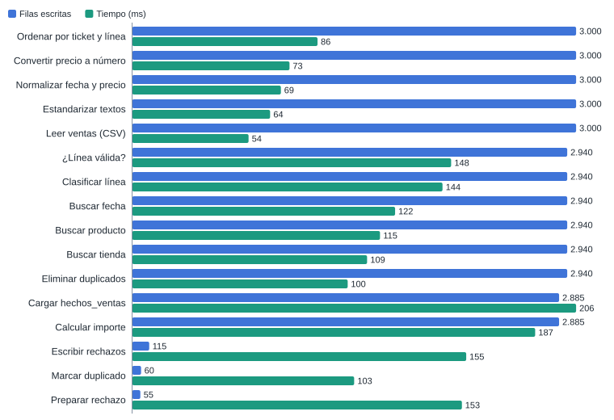

### Línea de tiempo de los steps

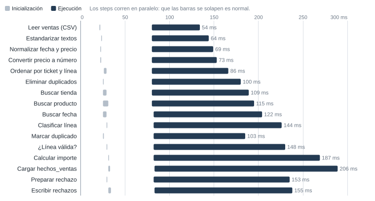

### Métricas por step

| Step | Leídas | Escritas | Entrada | Salida | Rechazadas | Errores | Estado | Tiempo | Filas/s |
| --- | ---: | ---: | ---: | ---: | ---: | ---: | --- | ---: | ---: |
| Leer ventas (CSV) | 0 | 3.000 | 3.001 | 0 | 0 | 0 | Terminado | 54 ms | 55.574 |
| Estandarizar textos | 3.000 | 3.000 | 0 | 0 | 0 | 0 | Terminado | 64 ms | 46.875 |
| Normalizar fecha y precio | 3.000 | 3.000 | 0 | 0 | 0 | 0 | Terminado | 69 ms | 43.478 |
| Convertir precio a número | 3.000 | 3.000 | 0 | 0 | 0 | 0 | Terminado | 73 ms | 41.096 |
| Ordenar por ticket y línea | 3.000 | 3.000 | 0 | 0 | 0 | 0 | Terminado | 86 ms | 34.884 |
| Eliminar duplicados | 3.000 | 2.940 | 0 | 0 | 60 | 0 | Terminado | 100 ms | 30.000 |
| Buscar tienda | 2.940 | 2.940 | 4 | 0 | 0 | 0 | Terminado | 109 ms | 26.972 |
| Buscar producto | 2.940 | 2.940 | 28 | 0 | 0 | 0 | Terminado | 115 ms | 25.565 |
| Buscar fecha | 2.940 | 2.940 | 30 | 0 | 0 | 0 | Terminado | 122 ms | 24.098 |
| Clasificar línea | 2.940 | 2.940 | 0 | 0 | 0 | 0 | Terminado | 144 ms | 20.417 |
| Marcar duplicado | 60 | 60 | 0 | 0 | 0 | 0 | Terminado | 103 ms | 583 |
| ¿Línea válida? | 2.940 | 2.940 | 0 | 0 | 0 | 0 | Terminado | 148 ms | 19.865 |
| Calcular importe | 2.885 | 2.885 | 0 | 0 | 0 | 0 | Terminado | 187 ms | 15.428 |
| Cargar hechos_ventas | 2.885 | 2.885 | 0 | 2.885 | 0 | 0 | Terminado | 206 ms | 14.005 |
| Preparar rechazo | 55 | 55 | 0 | 0 | 0 | 0 | Terminado | 153 ms | 359 |
| Escribir rechazos | 115 | 115 | 0 | 116 | 0 | 0 | Terminado | 155 ms | 748 |

## Validación

*Sin errores ni advertencias.*  

| Indicador | Valor |
| --- | --- |
| Errores | 0 |
| Advertencias | 0 |

## Conexiones y parámetros

*1 conexión y 0 parámetros.*  

### Conexiones a bases de datos

| Nombre | Tipo | Acceso | Host | Base | Usada por |
| --- | --- | --- | --- | --- | --- |
| dw_grano_de_oro | SQLite | Native |  | \${Internal.Entry.Current.Directory}/../salida/grano_de_oro_dw.sqlite | Buscar fecha, Buscar producto, Buscar tienda, Cargar hechos_ventas |

*Nunca se incluyen contraseñas.*  

## Conclusiones

- La carga es completa y trazable: cada línea del fichero termina en \`hechos_ventas\` o en el fichero de rechazos, con el motivo.
- La validación de Spoon no encuentra errores ni advertencias.
- El paso más lento es la escritura en SQLite («Cargar hechos_ventas»), lo esperable en una carga de este tamaño.

*Texto redactado con asistencia de IA*  

---

*Generado con Pentaho Live · IDC Studios*
