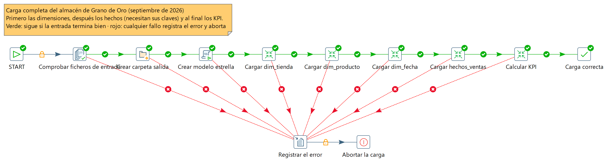
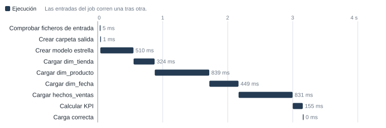

# Job de carga del modelo estrella · Grano de Oro

**Job · job_carga_dw**  
Informe del job job_carga_dw  
*Generado el 20 de octubre de 2026, 23:30*

Job job_carga_dw.

- Documento: job_carga_dw.kjb
- Tipo: Job
- Autor: Iván Castaño
- Institución: Universidad Europea de Madrid
- Curso: Proyecto de Big Data 1 · Práctica de ejemplo
- Creado: 2026-10-20 23:20
- Modificado: 2026-10-20 23:20

## Resumen

*Ejecuta 5 transformaciones (01_dim_tienda.ktr, 02_dim_producto.ktr, 03_dim_fecha.ktr, 04_hechos_ventas.ktr, 05_kpi_ventas.ktr), maneja archivos, ejecuta SQL y escribe en el log. 12 entradas y 18 hops.*  

El job orquesta la carga completa del modelo estrella: comprueba que estén los ficheros de entrada, crea la carpeta de salida y las tablas, carga las tres dimensiones (tiendas, productos y fechas), después los hechos y por último los KPI. Si algún paso falla, registra el error y aborta la carga. En la última ejecución todas las entradas terminaron correctamente.

*Texto redactado con asistencia de IA*  

| Indicador | Valor |
| --- | --- |
| Entradas del job | 12 |
| Hops | 18 |
| Transformaciones que ejecuta | 5 · 01_dim_tienda.ktr, 02_dim_producto.ktr, 03_dim_fecha.ktr, 04_hechos_ventas.ktr, 05_kpi_ventas.ktr |
| Jobs que ejecuta | 0 |
| Conexiones | 1 |

La última ejecución del job tardó 3,4 s y terminó bien; se ejecutaron 10 entradas. La entrada más lenta fue «Cargar dim_producto» (1,0 s).

### Lo más importante

- **Flujo del job:** 12 entradas y 18 hops. Ejecuta 5 transformaciones (01_dim_tienda.ktr, 02_dim_producto.ktr, 03_dim_fecha.ktr, 04_hechos_ventas.ktr, 05_kpi_ventas.ktr).
- **Validación:** 1 error y 0 advertencias.
- **Conexiones y parámetros:** 1 conexión y 0 parámetros.

## Flujo del job

*12 entradas y 18 hops. Ejecuta 5 transformaciones (01_dim_tienda.ktr, 02_dim_producto.ktr, 03_dim_fecha.ktr, 04_hechos_ventas.ktr, 05_kpi_ventas.ktr).*  

```mermaid
flowchart LR
  s1(["START"])
  s2["Comprobar ficheros de entrada<br/>Los archivos existen"]
  s3["Crear carpeta salida<br/>Crear carpeta"]
  s4["Crear modelo estrella<br/>SQL"]
  s5["Cargar dim_tienda<br/>Transformación"]
  s6["Cargar dim_producto<br/>Transformación"]
  s7["Cargar dim_fecha<br/>Transformación"]
  s8["Cargar hechos_ventas<br/>Transformación"]
  s9["Calcular KPI<br/>Transformación"]
  s10["Carga correcta<br/>Éxito"]
  s11["Registrar el error<br/>Escribir en el log"]
  s12["Abortar la carga<br/>Abortar el job"]
  s1 -->|"siempre"| s2
  s2 -->|"si termina bien"| s3
  s3 -->|"si termina bien"| s4
  s4 -->|"si termina bien"| s5
  s5 -->|"si termina bien"| s6
  s6 -->|"si termina bien"| s7
  s7 -->|"si termina bien"| s8
  s8 -->|"si termina bien"| s9
  s9 -->|"si termina bien"| s10
  s2 -.->|"si falla"| s11
  s3 -.->|"si falla"| s11
  s4 -.->|"si falla"| s11
  s5 -.->|"si falla"| s11
  s6 -.->|"si falla"| s11
  s7 -.->|"si falla"| s11
  s8 -.->|"si falla"| s11
  s9 -.->|"si falla"| s11
  s11 -->|"siempre"| s12
  linkStyle 1 stroke:#2a2,color:#2a2
  linkStyle 2 stroke:#2a2,color:#2a2
  linkStyle 3 stroke:#2a2,color:#2a2
  linkStyle 4 stroke:#2a2,color:#2a2
  linkStyle 5 stroke:#2a2,color:#2a2
  linkStyle 6 stroke:#2a2,color:#2a2
  linkStyle 7 stroke:#2a2,color:#2a2
  linkStyle 8 stroke:#2a2,color:#2a2
  linkStyle 9 stroke:#d33,color:#d33
  linkStyle 10 stroke:#d33,color:#d33
  linkStyle 11 stroke:#d33,color:#d33
  linkStyle 12 stroke:#d33,color:#d33
  linkStyle 13 stroke:#d33,color:#d33
  linkStyle 14 stroke:#d33,color:#d33
  linkStyle 15 stroke:#d33,color:#d33
  linkStyle 16 stroke:#d33,color:#d33
```

*Verde: si termina bien; rojo punteado: si falla; negro: siempre; las que terminan en x están deshabilitadas.*  

### Entradas del job

| \# | Entrada | Tipo | Qué hace |
| ---: | --- | --- | --- |
| 1 | START | Inicio (SPECIAL) | Inicio del job |
| 2 | Comprobar ficheros de entrada | Los archivos existen (FILES_EXIST) | Los archivos existen |
| 3 | Crear carpeta salida | Crear carpeta (CREATE_FOLDER) | Crear carpeta |
| 4 | Crear modelo estrella | SQL | Conexión: dw_grano_de_oro; SQL: DROP TABLE IF EXISTS hechos_ventas; DROP TABLE IF EXISTS kpi_ventas_tienda_categoria; DROP TABLE IF EXISTS kpi_ticket_medio_tienda; DROP TABLE IF EXISTS dim\_... |
| 5 | Cargar dim_tienda | Transformación (TRANS) | Ejecuta la transformación: \${Internal.Entry.Current.Directory}/01_dim_tienda.ktr |
| 6 | Cargar dim_producto | Transformación (TRANS) | Ejecuta la transformación: \${Internal.Entry.Current.Directory}/02_dim_producto.ktr |
| 7 | Cargar dim_fecha | Transformación (TRANS) | Ejecuta la transformación: \${Internal.Entry.Current.Directory}/03_dim_fecha.ktr |
| 8 | Cargar hechos_ventas | Transformación (TRANS) | Ejecuta la transformación: \${Internal.Entry.Current.Directory}/04_hechos_ventas.ktr |
| 9 | Calcular KPI | Transformación (TRANS) | Ejecuta la transformación: \${Internal.Entry.Current.Directory}/05_kpi_ventas.ktr |
| 10 | Carga correcta | Éxito (SUCCESS) | Termina el job con éxito. |
| 11 | Registrar el error | Escribir en el log (WRITE_TO_LOG) | Escribe en el log: «La carga del almacén de Grano de Oro ha fallado: la entrada que ha fallado es la última que aparece como «Starting entry» antes de este mensaje.» |
| 12 | Abortar la carga | Abortar el job (ABORT) | Aborta el job: termina con error y el mensaje «Carga abortada: el almacén puede haber quedado a medias. Corrige el error y vuelve a lanzar el job.». |

### Qué ejecuta

| Entrada | Tipo | Archivo | Existe |
| --- | --- | --- | --- |
| Cargar dim_tienda | Transformación | 01_dim_tienda.ktr | sí |
| Cargar dim_producto | Transformación | 02_dim_producto.ktr | sí |
| Cargar dim_fecha | Transformación | 03_dim_fecha.ktr | sí |
| Cargar hechos_ventas | Transformación | 04_hechos_ventas.ktr | sí |
| Calcular KPI | Transformación | 05_kpi_ventas.ktr | sí |

## Métricas de ejecución

*La última ejecución del job tardó 3,4 s y terminó bien; se ejecutaron 10 entradas. La entrada más lenta fue «Cargar dim_producto» (1,0 s).*  

| Indicador | Valor |
| --- | --- |
| Duración | 3,4 s · última ejecución en Spoon |
| Resultado | Bien |
| Entradas ejecutadas | 10 |
| Errores | 0 |
| Entrada más lenta | Cargar dim_producto · 1,0 s |

> [!NOTE]
> Las filas de las transformaciones que ejecuta un job solo se conocen al medirlo (Medir…).

### Línea de tiempo de las entradas

*Las filas anidadas (↳) son del sub-job o de la sub-transformación de arriba.*  

### Entradas del job

| Entrada | Job | Inicio | Duración | Resultado | Llegó por |
| --- | --- | ---: | ---: | --- | --- |
| START | job_carga_dw | +23 ms | 6 ms | Bien | el inicio del job |
| Comprobar ficheros de entrada | job_carga_dw | +30 ms | 5 ms | Bien | un hop incondicional |
| Crear carpeta salida | job_carga_dw | +36 ms | 1 ms | Bien | un hop «si termina bien» |
| Crear modelo estrella | job_carga_dw | +38 ms | 552 ms | Bien | un hop «si termina bien» |
| Cargar dim_tienda | job_carga_dw | +592 ms | 327 ms | Bien | un hop «si termina bien» |
| Cargar dim_producto | job_carga_dw | +920 ms | 1,0 s | Bien | un hop «si termina bien» |
| Cargar dim_fecha | job_carga_dw | +2,0 s | 461 ms | Bien | un hop «si termina bien» |
| Cargar hechos_ventas | job_carga_dw | +2,4 s | 833 ms | Bien | un hop «si termina bien» |
| Calcular KPI | job_carga_dw | +3,3 s | 142 ms | Bien | un hop «si termina bien» |
| Carga correcta | job_carga_dw | +3,4 s | 0 ms | Bien | un hop «si termina bien» |

## Validación

*1 error y 0 advertencias.*  

| Indicador | Valor |
| --- | --- |
| Errores | 1 (Error) |
| Advertencias | 0 |

| Step / entrada | Nivel | Mensaje |
| --- | --- | --- |
| Crear carpeta salida | Error | filename cannot be null. |

*Los mensajes de Kettle salen en el idioma de Spoon; los chequeos de Pentaho Live, en el del informe.*  

## Conexiones y parámetros

*1 conexión y 0 parámetros.*  

### Conexiones a bases de datos

| Nombre | Tipo | Acceso | Host | Base | Usada por |
| --- | --- | --- | --- | --- | --- |
| dw_grano_de_oro | SQLite | Native |  | \${Internal.Entry.Current.Directory}/../salida/grano_de_oro_dw.sqlite | Crear modelo estrella |

*Nunca se incluyen contraseñas.*  

---

*Generado con Pentaho Live · IDC Studios*
