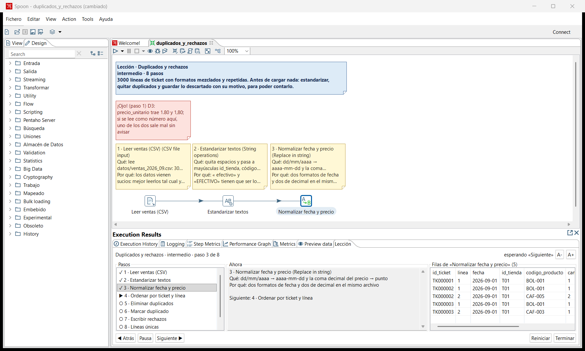
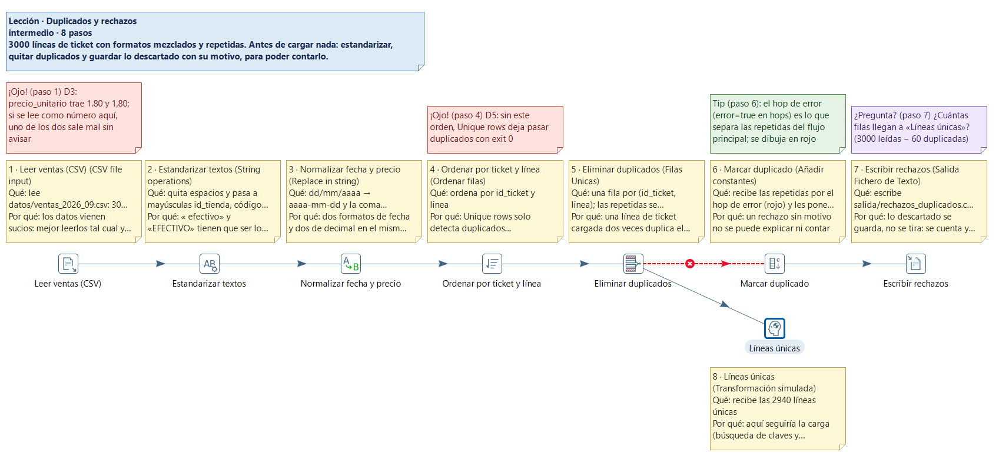
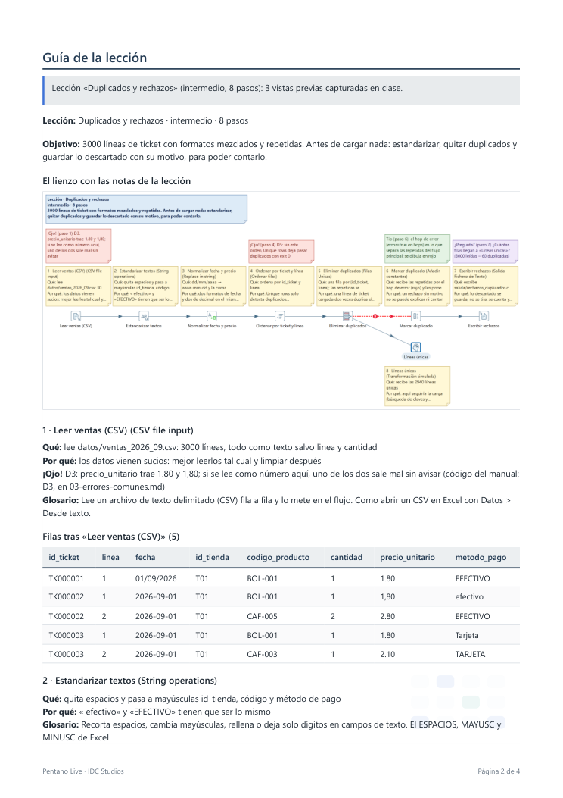

# Lección de la demo · Duplicados y rechazos

Una lección del **modo clase** de Pentaho Live (0.6.0) sobre los datos de «Grano de Oro»: Claude
construye una transformación paso a paso en el lienzo de Spoon y explica cada step con una nota, al ritmo
que marques con el botón **«Siguiente ▶»** de la pestaña **Lección**.

`leccion-duplicados-y-rechazos.es.json` es el guion: el argumento exacto de `lesson_start`. La
configuración de cada step sale de la solución de referencia
([../solucion-referencia/04_hechos_ventas.ktr](../solucion-referencia/04_hechos_ventas.ktr)), sin base de
datos.

## Qué se ve (8 pasos, unos 10 minutos)

| Paso | Step | Qué explica |
|---|---|---|
| 1 | Leer ventas (CSV) | 3000 líneas de ticket, todo como texto: los datos vienen sucios |
| 2 | Estandarizar textos | espacios y mayúsculas («  efectivo» = «EFECTIVO») |
| 3 | Normalizar fecha y precio | dos formatos de fecha y la coma decimal |
| 4 | Ordenar por ticket y línea | Unique rows solo ve duplicados consecutivos |
| 5 | Eliminar duplicados | una fila por (id_ticket, linea); las repetidas se rechazan |
| 6 | Marcar duplicado | llegan por el **hop de error** y reciben `motivo_rechazo = DUPLICADO` |
| 7 | Escribir rechazos | `salida/rechazos_duplicados.csv`: **60** líneas con su motivo |
| 8 | Líneas únicas | las **2940** que seguirían a la carga |

Los números están comprobados: la prueba `PruebaLeccionesListas` del plugin reproduce el guion entero sin
Spoon, ejecuta la transformación que queda y cuenta 60 rechazos `DUPLICADO` y 2940 líneas únicas
(3000 − 60), los mismos que la solución de referencia.

## Cómo se ve

En el paso 3, con la pestaña **Lección** abierta: la lista de pasos, el texto completo del paso actual, las filas
de su vista previa y los botones «◀ Atrás», «Pausa» y «Siguiente ▶». En el lienzo, cada step tiene su nota encima
(«Qué» y «Por qué», cortados a 6 líneas; el texto entero está en la pestaña y en la guía) y los «¡Ojo!» en rojo.

Al terminar, el lienzo entero: el hop de error de «Eliminar duplicados» a «Marcar duplicado» va en rojo, y la
rama de «Líneas únicas» lleva su nota debajo.

La guía para repartir (`build_report sections=["lesson"]`), aquí en PDF: la imagen del lienzo y, para cada paso,
el qué, el por qué, el aviso con su código del manual, la entrada del glosario y las filas que se vieron en clase.

## Cómo darla

1. Abre Spoon con Pentaho Live (0.6.0 o posterior) y Claude conectado.
2. Crea una transformación vacía y **guárdala** en esta carpeta, por ejemplo como
   `duplicados_y_rechazos.ktr`: los pasos leen `${Internal.Entry.Current.Directory}/../datos/` y escriben
   en `../salida/`. Sin guardar, `lesson_start` se niega (la vista previa no encontraría el CSV).
3. Pídele a Claude: «Da la lección de `leccion/leccion-duplicados-y-rechazos.es.json` sobre la
   transformación abierta». Si proyectas, añade «con letra 12» (`font_size`).
4. Avanza con **«Siguiente ▶»**. «◀ Atrás» deshace el último paso; «Pausa» la detiene; cada paso es un
   Ctrl+Z.
5. Al terminar:
   - `lesson_notes hide` quita las notas para el ejercicio (siguen guardadas dentro del `.ktr`: ocultar no
     es secreto) y `show` las devuelve;
   - `build_report sections=["lesson"] formats=["pdf","docx"]` genera la guía para repartir, con la imagen
     del lienzo, el texto de cada paso y las filas que se vieron en clase.

**Ejercicio** (al final de la lección): añadir la regla `CANTIDAD_NO_VALIDA` (cantidad ≤ 0) con un
Filter rows antes de «Líneas únicas» y mandar esas filas a «Escribir rechazos» con su motivo. La solución
completa, con todas las reglas, está en `../solucion-referencia/04_hechos_ventas.ktr`.

Más lecciones listas (L1-L3, en es/en/pt) y cómo escribir una: `claude/skills/pentaho-etl/lecciones/` y
`claude/skills/pentaho-etl/manual/08-modo-clase.md`.
