# Grano de Oro · carga del almacén de ventas

**grano-de-oro.plan.yaml**  
Plano ETL · diseño antes de construir  
*Generado el 25 de octubre de 2026, 23:55*

Cargar cada mes las ventas de las cuatro cafeterías en un modelo en estrella de SQLite y calcular las ventas por tienda y categoría y el ticket medio, sin hacerlo a mano en una hoja de cálculo.

- Archivo: grano-de-oro.plan.yaml
- Grano: una fila por línea de ticket válida (id_ticket, linea)
- Carga: completa (todo el histórico)
- 3 fuentes · 7 destinos · 29 etapas · 5 transformaciones

## Resumen del plano

*3 fuentes, 7 destinos y 29 etapas. La revisión encuentra 0 errores y 2 avisos.*  

| Campo | Valor |
| --- | --- |
| Objetivo | Cargar cada mes las ventas de las cuatro cafeterías en un modelo en estrella de SQLite y calcular las ventas por tienda y categoría y el ticket medio, sin hacerlo a mano en una hoja de cálculo. |
| Grano | una fila por línea de ticket válida (id_ticket, linea) |
| Carga | completa (todo el histórico) |
| Transformaciones | 01_dim_tienda, 02_dim_producto, 03_dim_fecha, 04_hechos_ventas, 05_kpi_ventas |
| Job de orquestación | job_carga_dw |
| Dónde se ejecuta | Kitchen, una vez al mes |

## Flujo de datos

*De dónde salen los datos, por qué etapas pasan y en qué almacenes terminan. Las líneas punteadas azules son búsquedas y las rojas, rechazos.*  

### Flujo de datos · 01_dim_tienda

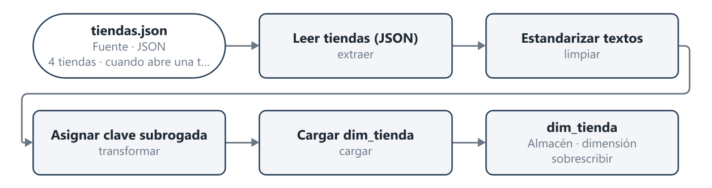

Código Mermaid del diagrama (para Obsidian y GitHub)

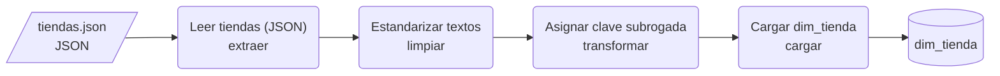

### Flujo de datos · 02_dim_producto

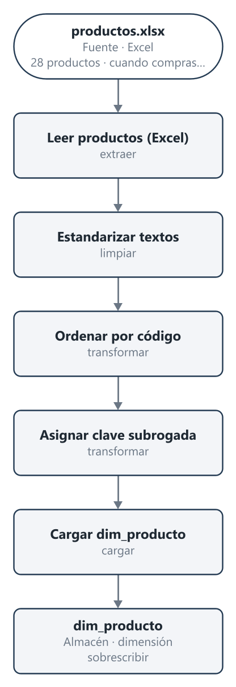

Código Mermaid del diagrama (para Obsidian y GitHub)

```mermaid
flowchart LR
  n_s_productos[/"productos.xlsx<br/>Excel"/]
  n_e_leer_productos("Leer productos (Excel)<br/>extraer")
  n_e_estandarizar_productos("Estandarizar textos<br/>limpiar")
  n_e_ordenar_productos("Ordenar por código<br/>transformar")
  n_e_sk_producto("Asignar clave subrogada<br/>transformar")
  n_e_cargar_dim_producto("Cargar dim_producto<br/>cargar")
  n_d_dim_producto[("dim_producto")]
  n_s_productos --> n_e_leer_productos
  n_e_leer_productos --> n_e_estandarizar_productos
  n_e_estandarizar_productos --> n_e_ordenar_productos
  n_e_ordenar_productos --> n_e_sk_producto
  n_e_sk_producto --> n_e_cargar_dim_producto
  n_e_cargar_dim_producto --> n_d_dim_producto
```

### Flujo de datos · 03_dim_fecha

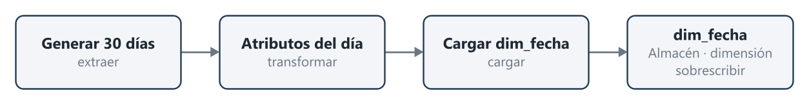

Código Mermaid del diagrama (para Obsidian y GitHub)

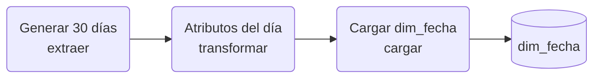

### Flujo de datos · 04_hechos_ventas

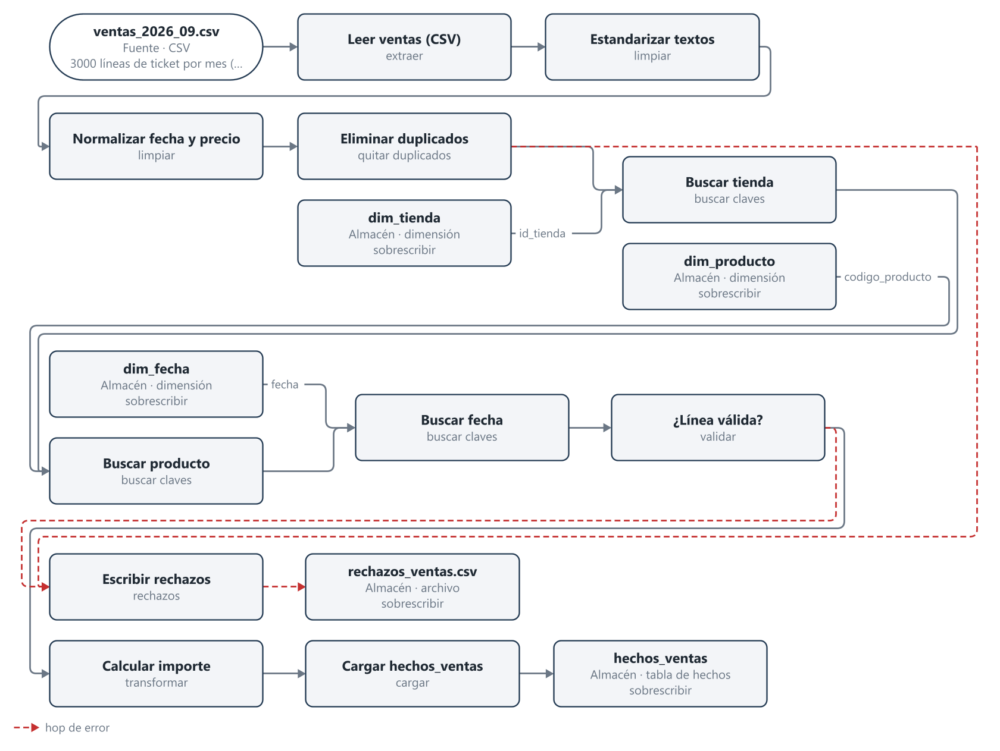

Código Mermaid del diagrama (para Obsidian y GitHub)

```mermaid
flowchart LR
  n_s_ventas[/"ventas_2026_09.csv<br/>CSV"/]
  n_e_leer_ventas("Leer ventas (CSV)<br/>extraer")
  n_e_estandarizar_ventas("Estandarizar textos<br/>limpiar")
  n_e_normalizar_ventas("Normalizar fecha y precio<br/>limpiar")
  n_e_deduplicar("Eliminar duplicados<br/>quitar duplicados")
  n_e_buscar_tienda("Buscar tienda<br/>buscar claves")
  n_e_buscar_producto("Buscar producto<br/>buscar claves")
  n_e_buscar_fecha("Buscar fecha<br/>buscar claves")
  n_e_validar_linea("¿Línea válida?<br/>validar")
  n_e_calcular_importe("Calcular importe<br/>transformar")
  n_e_cargar_hechos("Cargar hechos_ventas<br/>cargar")
  n_e_escribir_rechazos("Escribir rechazos<br/>rechazos")
  n_d_dim_tienda[("dim_tienda")]
  n_d_dim_producto[("dim_producto")]
  n_d_dim_fecha[("dim_fecha")]
  n_d_hechos_ventas[("hechos_ventas")]
  n_d_rechazos_ventas[("rechazos_ventas.csv")]
  n_s_ventas --> n_e_leer_ventas
  n_e_leer_ventas --> n_e_estandarizar_ventas
  n_e_estandarizar_ventas --> n_e_normalizar_ventas
  n_e_normalizar_ventas --> n_e_deduplicar
  n_e_deduplicar --> n_e_buscar_tienda
  n_d_dim_tienda -. "id_tienda" .-> n_e_buscar_tienda
  n_e_buscar_tienda --> n_e_buscar_producto
  n_d_dim_producto -. "codigo_producto" .-> n_e_buscar_producto
  n_e_buscar_producto --> n_e_buscar_fecha
  n_d_dim_fecha -. "fecha" .-> n_e_buscar_fecha
  n_e_buscar_fecha --> n_e_validar_linea
  n_e_validar_linea --> n_e_calcular_importe
  n_e_calcular_importe --> n_e_cargar_hechos
  n_e_cargar_hechos --> n_d_hechos_ventas
  n_e_validar_linea -.-> n_e_escribir_rechazos
  n_e_deduplicar -.-> n_e_escribir_rechazos
  n_e_escribir_rechazos --> n_d_rechazos_ventas
```

### Flujo de datos · 05_kpi_ventas

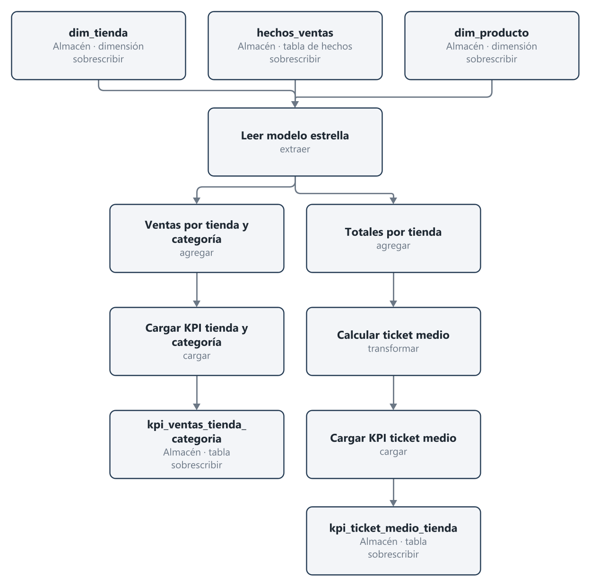

Código Mermaid del diagrama (para Obsidian y GitHub)

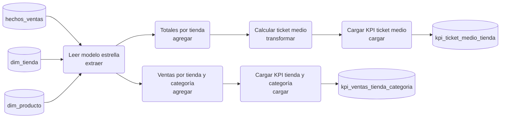

## Actividad de la orquestación (UML)

*Qué transformación corre detrás de cuál y qué pasa si una falla.*  

### Actividad · job_carga_dw

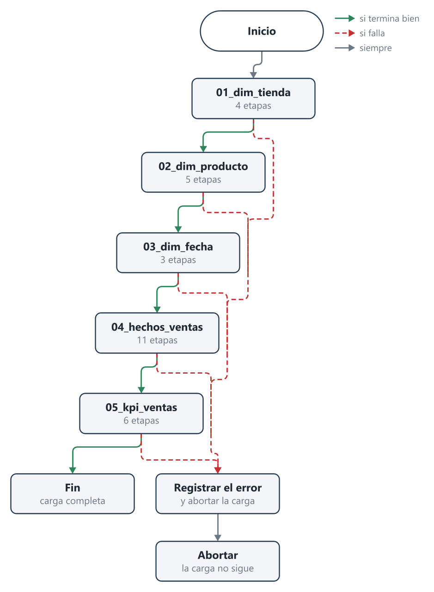

Código Mermaid del diagrama (para Obsidian y GitHub)

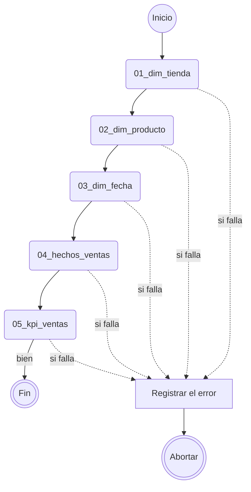

## Componentes y despliegue

*Dónde vive cada pieza (carpetas, bases de datos, el equipo que ejecuta) y quién lee o escribe qué.*  

### Componentes y despliegue · Grano de Oro · carga del almacén de ventas

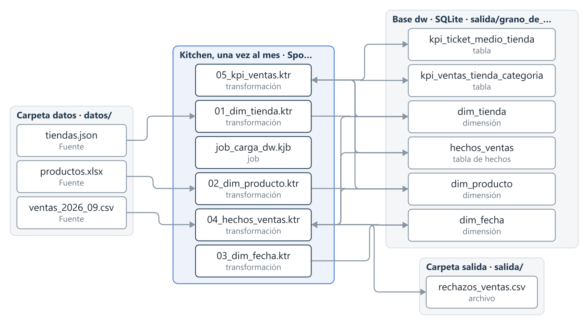

Código Mermaid del diagrama (para Obsidian y GitHub)

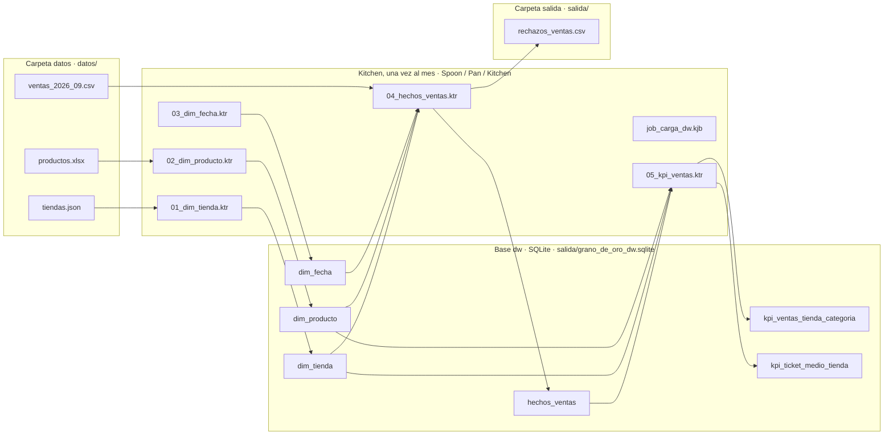

## Fuentes

| Id | Nombre | Formato | Ubicación | Volumen | Frecuencia | Clave | Rechazos |
| --- | --- | --- | --- | --- | --- | --- | --- |
| ventas | ventas_2026_09.csv | csv | datos/ventas_2026_09.csv | 3000 líneas de ticket por mes (muestra de uno de cada diez tickets) | mensual | id_ticket, linea | salida/rechazos_ventas.csv |
| productos | productos.xlsx | excel | datos/productos.xlsx | 28 productos | cuando compras cambia el catálogo | codigo_producto |  |
| tiendas | tiendas.json | json | datos/tiendas.json | 4 tiendas | cuando abre una tienda | id_tienda |  |

## Destinos

| Id | Nombre | Tipo | Ubicación | Clave | Carga |
| --- | --- | --- | --- | --- | --- |
| dim_tienda | dim_tienda | dimensión | salida/grano_de_oro_dw.sqlite | id_tienda | sobrescribir |
| dim_producto | dim_producto | dimensión | salida/grano_de_oro_dw.sqlite | codigo_producto | sobrescribir |
| dim_fecha | dim_fecha | dimensión | salida/grano_de_oro_dw.sqlite | fecha | sobrescribir |
| hechos_ventas | hechos_ventas | tabla de hechos | salida/grano_de_oro_dw.sqlite | id_ticket, linea | sobrescribir |
| rechazos_ventas | rechazos_ventas.csv | archivo | salida/rechazos_ventas.csv |  | sobrescribir |
| kpi_categoria | kpi_ventas_tienda_categoria | tabla | salida/grano_de_oro_dw.sqlite | tienda, categoria | sobrescribir |
| kpi_ticket | kpi_ticket_medio_tienda | tabla | salida/grano_de_oro_dw.sqlite | tienda | sobrescribir |

## Reglas de negocio

| Id | Regla | Etapas |
| --- | --- | --- |
| R1 | Todas las fechas pasan a aaaa-MM-dd (llegan como aaaa-MM-dd y como dd/MM/aaaa). | Normalizar fecha y precio |
| R2 | Los precios se leen con punto decimal aunque vengan con coma; el resultado no depende del idioma del equipo. | Normalizar fecha y precio |
| R3 | metodo_pago en mayúsculas y sin espacios, solo TARJETA, EFECTIVO o BIZUM. | Estandarizar textos |
| R4 | id_tienda y codigo_producto sin espacios y en mayúsculas. | Estandarizar textos, Estandarizar textos, Estandarizar textos |
| R5 | En el catálogo, nombres sin espacios sobrantes y una sola forma de cada categoría con inicial mayúscula. | Estandarizar textos |
| R6 | Un mismo (id_ticket, linea) se carga una sola vez; las copias se rechazan como DUPLICADO. | Eliminar duplicados |
| R7 | Motivo de rechazo, el primero que se cumpla: DUPLICADO, TIENDA_VACIA, CANTIDAD_NO_VALIDA, TIENDA_DESCONOCIDA, PRODUCTO_DESCONOCIDO, FECHA_NO_VALIDA. | ¿Línea válida? |
| R8 | sk_fecha con formato aaaammdd; dia_semana de 1 (lunes) a 7 (domingo); es_fin_de_semana S o N. | Atributos del día |
| R9 | importe = precio_unitario × cantidad, redondeado a 2 decimales. | Calcular importe |
| R10 | Ventas por tienda y categoría (unidades e importe), calculadas desde el modelo estrella. | Ventas por tienda y categoría |
| R11 | ticket_medio = importe_total / tickets distintos con al menos una línea válida, con la mitad hacia arriba. | Calcular ticket medio |

## Etapas

### 01_dim_tienda

| Etapa | Tipo | Después de | Lee | Escribe | Reglas | Step sugerido |
| --- | --- | --- | --- | --- | --- | --- |
| Leer tiendas (JSON) | extraer |  | tiendas.json |  |  | JsonInput |
| Estandarizar textos | limpiar | Leer tiendas (JSON) |  |  | R4 | StringOperations |
| Asignar clave subrogada — sk_tienda consecutiva desde 1 | transformar | Estandarizar textos |  |  |  | Sequence |
| Cargar dim_tienda | cargar | Asignar clave subrogada |  | dim_tienda |  | TableOutput |

### 02_dim_producto

| Etapa | Tipo | Después de | Lee | Escribe | Reglas | Step sugerido |
| --- | --- | --- | --- | --- | --- | --- |
| Leer productos (Excel) | extraer |  | productos.xlsx |  |  | ExcelInput |
| Estandarizar textos | limpiar | Leer productos (Excel) |  |  | R4, R5 | StringOperations |
| Ordenar por código — el orden fija las claves subrogadas | transformar | Estandarizar textos |  |  |  | SortRows |
| Asignar clave subrogada — sk_producto consecutiva desde 1 | transformar | Ordenar por código |  |  |  | Sequence |
| Cargar dim_producto | cargar | Asignar clave subrogada |  | dim_producto |  | TableOutput |

### 03_dim_fecha

| Etapa | Tipo | Después de | Lee | Escribe | Reglas | Step sugerido |
| --- | --- | --- | --- | --- | --- | --- |
| Generar 30 días — dim_fecha no sale de ningún fichero, se genera | extraer |  |  |  |  | RowGenerator |
| Atributos del día | transformar | Generar 30 días |  |  | R8 | Formula |
| Cargar dim_fecha | cargar | Atributos del día |  | dim_fecha |  | TableOutput |

### 04_hechos_ventas

| Etapa | Tipo | Después de | Lee | Escribe | Reglas | Step sugerido |
| --- | --- | --- | --- | --- | --- | --- |
| Leer ventas (CSV) | extraer |  | ventas_2026_09.csv |  |  | CsvInput |
| Estandarizar textos | limpiar | Leer ventas (CSV) |  |  | R3, R4 | StringOperations |
| Normalizar fecha y precio | limpiar | Estandarizar textos |  |  | R1, R2 | ReplaceString |
| Eliminar duplicados — ordenar antes por id_ticket y linea; las copias salen por el hop de error | quitar duplicados | Normalizar fecha y precio |  |  | R6 | Unique |
| Buscar tienda | buscar claves | Eliminar duplicados | busca en dim_tienda por id_tienda |  |  | DBLookup |
| Buscar producto | buscar claves | Buscar tienda | busca en dim_producto por codigo_producto |  |  | DBLookup |
| Buscar fecha | buscar claves | Buscar producto | busca en dim_fecha por fecha |  |  | DBLookup |
| ¿Línea válida? | validar | Buscar fecha |  |  | R7 | FilterRows |
| Calcular importe | transformar | ¿Línea válida? |  |  | R9 | Calculator |
| Cargar hechos_ventas | cargar | Calcular importe |  | hechos_ventas |  | TableOutput |
| Escribir rechazos — hechos + rechazos = líneas del CSV | rechazos | ¿Línea válida?, Eliminar duplicados |  | rechazos_ventas.csv |  | TextFileOutput |

### 05_kpi_ventas

| Etapa | Tipo | Después de | Lee | Escribe | Reglas | Step sugerido |
| --- | --- | --- | --- | --- | --- | --- |
| Leer modelo estrella | extraer |  | hechos_ventas, dim_tienda, dim_producto |  |  | TableInput |
| Ventas por tienda y categoría | agregar | Leer modelo estrella |  |  | R10 | GroupBy |
| Cargar KPI tienda y categoría | cargar | Ventas por tienda y categoría |  | kpi_ventas_tienda_categoria |  | TableOutput |
| Totales por tienda — importe total y tickets distintos por tienda | agregar | Leer modelo estrella |  |  |  | GroupBy |
| Calcular ticket medio | transformar | Totales por tienda |  |  | R11 | Calculator |
| Cargar KPI ticket medio | cargar | Calcular ticket medio |  | kpi_ticket_medio_tienda |  | TableOutput |

## Riesgos y decisiones

| Riesgo | Mitigación |
| --- | --- |
| El TPV reenvió un lote y hay líneas repetidas. | Ordenar por id_ticket y linea y eliminar duplicados; las copias van a rechazos como DUPLICADO (R6). |
| En un equipo en español 2.50 se lee como 250 sin dar error. | Pasar el precio a texto con punto decimal y convertirlo con símbolo decimal explícito (R2). |
| Códigos de producto o tiendas que no existen en las dimensiones. | Las búsquedas rechazan los huérfanos con su motivo (on_missing reject). |

| Decisión | Por qué |
| --- | --- |
| Carga completa en cada ejecución; el job vuelve a crear el modelo estrella antes de cargar. | Es una muestra mensual pequeña y así repetir la carga deja siempre el mismo resultado. |
| dim_fecha se genera (los 30 días de septiembre) en lugar de salir de las ventas. | Así un día sin ventas también existe en la dimensión. |
| sk_fecha es una clave inteligente aaaammdd; sk_tienda y sk_producto son subrogadas consecutivas. | Lo pide el enunciado (3.1). |

## Revisión del plano

*0 errores, 2 avisos y 0 sugerencias.*  

> [!WARNING]
> La fuente «productos.xlsx» no tiene plan de rechazos: una fila mala pararía la carga o se perdería sin rastro. Pon rejects (el archivo de rechazos con su motivo) o una etapa de tipo reject después de la que la lee. Pregunta: ¿Qué hacemos con las filas de «productos.xlsx» que no pasan la validación: se apartan a un archivo con el motivo o se para la carga?

> [!WARNING]
> La fuente «tiendas.json» no tiene plan de rechazos: una fila mala pararía la carga o se perdería sin rastro. Pon rejects (el archivo de rechazos con su motivo) o una etapa de tipo reject después de la que la lee. Pregunta: ¿Qué hacemos con las filas de «tiendas.json» que no pasan la validación: se apartan a un archivo con el motivo o se para la carga?

---

*Generado con Pentaho Live · IDC Studios*
